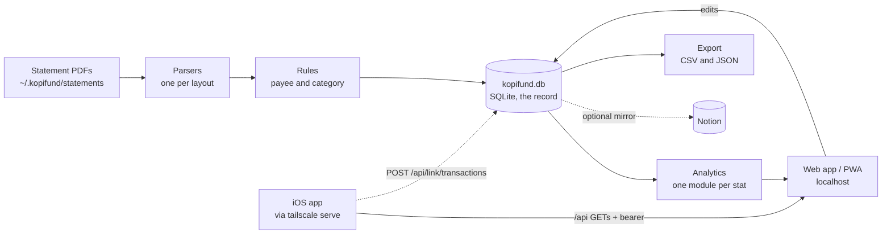

# Kopifund spec

## The problem

Someone in Singapore with a normal financial life holds money in five or more
places: a DBS or POSB account, PayLah!, a travel card like YouTrip, Revolut or
Wise for overseas, a brokerage, and CPF. No single app sees all of it. Bank apps
show one account each, budgeting apps want a bank login most local banks do not
offer, and CPF and the brokerage sit outside both.

Every one of those places already sends a monthly or yearly PDF statement.
Together the statements hold the whole picture. Nobody reads them as one ledger,
so questions like "what did I actually spend last month", "how long does my cash
last" and "what am I worth including CPF" go unanswered.

## Who it is for

People in Singapore who want a full, accurate picture of their money without
handing a bank login to a third party, and who are willing to download their
statements once a month. The first user is the owner, whose accounts set the
v1 list of supported statements. Kopifund is meant to ship to other people,
so nothing about one user's accounts may be hardcoded into tracked code.

## What it does

### Look back

- **Ingest.** Read every statement PDF in the data folder, detect its layout
  from the text inside it, and turn it into transaction rows plus a balance
  block per account per month. A statement that does not balance (opening plus
  in minus out against the printed closing) stops the run instead of loading
  wrong rows. Every path applies that check before it uses a row: a statement
  missing the balance its check needs (a Wise closing, a Revolut balance
  summary) stops its parser before anything is written, a reused parser run
  (`rollup`, `payees`, `add-options` and `verify` with `--csv`, `analyse
  --from-csv`) goes through the same block checks as a fresh one, and a CPF
  year that does not reconcile is left out and named.
- **Name and categorise.** Tiered rule files map each row to a payee and a
  category. Rows no rule matches are listed, biggest first, so the next rule
  to write is obvious. A one-off row can be set on its own instead.
- **Separate real spending from shuffling.** Every row gets a flow class: money
  crossing the boundary of the user's own holdings (`External`) or moving
  between them (top-ups, wallet exchanges, own-account transfers). Only
  `External` rows count as spending or income.
- **Views.** Monthly cash flow, category breakdown, needs against wants against
  savings, recurring payments, eating out, top payees, one-off purchases,
  income stability, trips, cash runway, the brokerage portfolio, CPF, and
  comparisons against sourced Singapore benchmarks.

### Plan ahead

- **Budgets.** A planned amount per category per month, with the actual filled
  in from the ledger and the variance shown. The editor opens on the record's
  last month, because statements arrive a month or more late and today's month
  has no actuals yet. Categories are grouped by bucket, each bucket with a
  total row (planned, actual and how much is used), and income in a table of
  its own. Need classes are set on the Categories page, not here.
- **Forward view.** Month by month projection of cash from the user's income
  plan, their real median spending, investing transfers and known one-off
  payments, with scenarios (with or without trips, with or without one-offs).
- **Runway and net worth.** Months of expenses the cash covers, and net worth as
  cash plus investments plus CPF, with the locked CPF share shown apart. Net
  worth is drawn month by month, and drawn forward over 10, 20 or 30 years or
  to 65 from inputs the owner types and saves: income rows, investing steps,
  spending and the assumptions (G14, "Net worth and growth" below).

Kopifund describes and projects. It does not give investment advice and does not
tell anyone where to keep their money.

## Architecture



- **Backend.** The Python pipeline from
  finance-tracking moves into
  this repo (G3): parsers, rules, the Notion sync, the analytics stats and
  their tests. It runs as a local server on the user's machine, because PDF
  parsing uses `pdftotext` (poppler). [serve.py](server/serve.py) is that server: it
  binds `127.0.0.1:8770` only, serves the built app from `apps/web/dist`, answers
  `/api/*` with JSON. Every write is a POST that must carry the header
  `X-Kopifund: 1` and, when the browser sends one, an Origin on this machine,
  so a page on another site cannot write. The phone link ("Phone link (G25)"
  below) is the only way a request reaches the API off this machine, and it
  arrives on loopback too, through `tailscale serve`. The routes are listed at the top of
  serve.py, and in it `GET_ROUTES` and `POST_ROUTES` are the one table that
  finds each (G19): a path, or a pattern like `/api/uploads/<id>`, and the
  function that answers it. serve.py holds the HTTP handler and that table;
  the answers are in [server/finance/api.py](server/finance/api.py) (the GETs),
  [server/finance/api_writes.py](server/finance/api_writes.py) (the POSTs) and
  [server/analytics/api.py](server/analytics/api.py) (Net worth and the projection), and
  the data version, the stat results cache, the stats rebuild, the upload
  steps and `--reload` each have a module of their own. A write that reads a JSON body gets an object or
  a 400, "The body is a JSON object". A request opens at most one connection
  to the record, and the server closes it when the request ends. For development, `make dev` runs it with `--reload` (a fresh
  server whenever a Python file changes) and `--page http://localhost:5173`,
  which sends every page asked of 8770 to the Vite dev server instead of
  serving `apps/web/dist`, so a build older than the code is never what shows.
  Python stays stdlib-only, like the pipeline it is joining.
- **Packages (G19).** `finance` holds the record, the sync, the app's answers
  and the parsers (`finance.parsers`, one module per feed, each also a command
  line: `cd server && python3 -m finance.parsers.parse_statements`). `analytics` holds the
  stats and imports `finance`; `finance` never imports `analytics`, so what
  both need (the snapshot, the CPF rules, the `[analytics]` settings, the net
  worth series, the Metrics rows and the recurring detector's engine,
  `server/finance/cadence.py`) lives in `finance`. serve.py, which holds
  both, hands finance the stats rebuild a load ends with. Every module under
  server/ is imported normally: no file there puts a folder on `sys.path` (the
  `docs/gen_*` scripts prepend `server/` so `finance` imports from the repo
  root), and server/tests/test_layering.py checks both rules.
- **One layout registry (G21).** Each parser module declares the statement
  layouts it reads in `server/finance/parsers/layouts.py`: name, parser, the Upload
  page's words, the layout test (with the account number and currency it
  prints), the statement folder, the kind (bank account, wallet, card,
  brokerage, CPF) and how an upload is named. The Upload page's sniffing, the
  run, the upload's naming and folder checks, Setup's provider list, the
  select values `add-options` adds ahead of the data and the layouts table in
  docs/parsing.md all read it, so a new layout is one `parse_<name>.py`
  module and nothing else. The module also declares its bank (the key of the
  mark the app draws and the words that give it away in an account's name),
  the name of an account kept in its folder, and the layout's status, "checked
  on a real statement" or "from a public sample" (a new layout starts at the
  second, and Setup and docs/parsing.md show the same words); `server/finance/account_names.py`,
  the wallet folders the snapshot counts, the statement folders the API sends
  (each with its `title` and `bank`) and Setup's provider list read those, so
  no page keeps a list of banks of its own.
- **Record.** `kopifund.db`, one SQLite file in the data folder, is the record
  (G4). It holds every table in the domain model below, and the app reads and
  edits it directly through the API. Python's built-in `sqlite3` drives it, so
  the backend stays stdlib-only. The sync keeps its current guarantee: it
  writes only what differs, then reads back and verifies, so a rerun is always
  safe.
- **Notion mirror.** Optional. When a Notion token and database ids are
  configured, the sync copies the loader-owned tables to Notion one way after
  every successful write. Users without Notion lose nothing. The mirror also
  creates any Categories row Notion lacks that a row to be written (or, in
  `finance.py payees`, a payee's default category) links to, when the record
  holds that category (or the load is about to add it from the shipped list).
  It does so before the first row or budget links to it, with the name,
  Bucket, Group, Need class and Sort order the record has; a property or
  select option Categories lacks is left out, never added. A Categories row
  already in Notion is never patched, and a second run creates nothing. A
  category the rules name that the record does not hold (a typo, or the old
  name of a renamed one) still stops the run at `missing-category`. A dry run
  says "would create N categories in Notion: ..." and writes nothing. Verify
  then reads Categories back too and reports a row still missing.
- **The app owns what the user types.** Categories (bucket, group, need
  class, sort order, and the bucket on the Categories page that holds each
  one), budget planned amounts, trips, the plan, and account and
  card details are edited in the app and live only in SQLite. An owner who
  typed them in Notion imports them once with `finance.py import-notion`. Each
  sync then runs in this order:
  1. parse, categorise and write the loader-owned tables to SQLite;
  2. mirror the loader-owned tables to Notion, when Notion is configured.
  Apart from creating a missing Categories row (above), the mirror never
  writes a user-owned field, and nothing is read back from Notion, so an edit
  made there after the import is not seen.
- **Front end.** A web app in [apps/web/](apps/web/), installable as a PWA, used mostly
  from a desktop browser. It shows every stat card and adds the monthly upload,
  rules and planning on top.
- **Shared types (G17).** What an endpoint sends is written once, in Python:
  [server/finance/types.py](server/finance/types.py) holds a `TypedDict` per JSON object
  (`Cents` for integer cents, a `Literal` over the tuple the code already
  checks for each enum, `NotRequired` only where a handler leaves a key out).
  `make types` (`cd server && python3 -m finance.gen_types`, stdlib only) writes them to
  [apps/web/src/types.gen.ts](apps/web/src/types.gen.ts) with serve.py's cached and
  no-change route lists, and [apps/web/src/api.ts](apps/web/src/api.ts) re-exports them
  under the names the pages import. [server/tests/test_types.py](server/tests/test_types.py)
  fails when the committed file is stale, and runs the plan, transactions,
  trips, categories, budgets, rules, recurring, profile, scam-checks and
  uploads endpoints on a small record, with the answer to a plan save and the
  Net worth inputs in the growth answer, checking every key and value at
  every level against the TypedDicts. A server change that renames a key now
  fails `make check` instead of a page. Home, the rest of the projection and
  the stat results are still typed by hand in api.ts. A string under a key in a
  TypedDict is that key's comment; one that starts "Deprecated" marks the key
  `@deprecated`, so an editor strikes out a page that still reads it.
- **Writes name rows by id (G17).** Every read that lists trips, categories,
  buckets or budget rows sends each row's `id` (a budget row sends
  `category_id`: a budget is one category in one month and has no id of its
  own; a budget bucket from a record before buckets has a null `id`). Every
  write for them takes the id and uses it: `POST /api/trips` (`id`; none makes
  a new trip), `trips/remove` (`id`), `trips/restore` and `trips/undo` (the
  ids inside what the server answered), `/api/categories` and
  `categories/rename`, `move`, `delete` (`id`, with `group_id` or
  `move_to_id` for where it goes), `categories/add` (`group_id`),
  `/api/category-groups/rename` and `delete` (`id`, `move_to_id`), `reorder`
  (`ids`), and `/api/budgets` (`category_id`). `budgets/copy` names months
  only. Names are still accepted, for one release, where no id is sent, so a
  tab opened before this keeps working: the writes then go by name as before.
  A name sent beside an id is the name the page read, and must still be the
  row's: a row renamed in another tab, or an id SQLite handed to a newer row
  after a delete, is refused with "That category is called Kopi now, not
  Coffee: reload the page", and nothing is written (`db.pick`). A rename by id
  needs no old name, but a write that moves or deletes what hangs off a row
  (a category or bucket delete, a category move, a trip remove) needs the
  name beside every id it sends, where the rows go included, so an id alone
  never lands them on a newer row. A reorder that sends `names` beside `ids`
  must match them place by place. A removed trip's Undo puts it back under
  its old id, unless a trip made meanwhile holds that id. The pages send the
  name they show beside every id.
- **Storage.** Everything personal lives in one data folder outside the repo,
  `~/.kopifund` by default, or wherever `KOPIFUND_DATA` points. Nothing in it
  is ever committed. An export writes the ledger and the stat results as CSV
  and JSON for analysis elsewhere. Two narrower overrides exist for tests and
  tooling: `KOPIFUND_DB` moves the record (default `kopifund.db` in the data
  folder) and `KOPIFUND_CACHE` moves the derived cache (default `cache/` in
  the data folder). The test suite sets both to a throwaway folder on every
  run, so no test can write a real record or cache.

### The data folder

Chosen after the [October data audit](docs/data-audit-2026-10.md).

```
~/.kopifund/                      KOPIFUND_DATA overrides the location
  kopifund.db                     the record
  config.toml                     settings only: folders, parsers, Notion mirror on or off
  devices.json                    the paired phones: id, name, token hash, paired date, revoked flag (G25); mode 600
  profile.json                    about the owner, what no statement prints: the date of birth (CPF age bands, 55 and 65)
  SOURCES.yml                     where each account's statements come from, one entry per account, no identifiers
  statements/<account>/YYYY/      original PDFs, renamed on import (dbs-multiplier, posb-everyday,
                                  dbs-paylah, dbs-debit-cards, youtrip-<ccy>, revolut, wise-<ccy>,
                                  tiger, cpf)
    YYYY-MM.pdf                   a monthly statement
    YYYY-MM_YYYY-MM.pdf           a statement covering a range, or a Tiger year (to date)
    YYYY.pdf                      a CPF yearly statement
    export-YYYY-MM-DD.pdf         an all-time export (Revolut, Wise), kept per export date
  documents/                      files with no parser: school bills and advices, invoices, receipts
  rules/                          personal rule tiers: keys.csv, types.csv, people.csv, merchants.csv
  rules-history/                  the 50 newest app writes to rules/, each file's old content, for undo
  places.csv                      the towns of the owner's stays and trips, read after the shipped city table
  notes/                          the owner's notes, copied as they were
  exports/                        CSV and JSON written by an export
  backups/                        dated archives of the db, rules, config and notes; never cache, never secrets
  cache/                          text dumps, parser output, stat results; delete freely
```

- **Statements are renamed on import, never edited.** The import copies a PDF to
  its canonical name and records the original name, the sha256 and the import
  date in the `statement_file` table. The same sha256 twice is refused, which
  ends double-loading a copied PDF. A check, not the database, says so before a
  load writes anything: the same bytes at two paths is `same-file-two-places`
  (a byte copy also collides on its month, and that `duplicate-period` is left
  out, so one mistake is one problem),
  and a file that now sits in a different account's folder than the record last
  saw it is `statement-moved`. Both stop a load like any blocking problem and
  name the paths; a rename inside one account folder is not a problem, the record
  follows the file.
- **Nothing is overwritten.** A new Revolut, Wise or Tiger year-to-date export
  sits beside the older one; the older is marked superseded in the database.
- **Account folders are named `<provider>-<account>`** (`posb-everyday`,
  `youtrip-sgd`). A YouTrip or Wise wallet is its own folder; YouTrip's carries
  the wallet currency, which the parser still checks against the statement
  heading. Every folder of one parser is still parsed in a single run, so the
  wallets see each other's exchanges and top-ups.
- **The newest export counts.** Of several `export-*` files in one account
  folder only the newest is parsed, and of two ranges starting in the same
  month only the one that ends last (server/finance/paths.py, `current_statements`).
  Until G4 records it in the database, superseded is decided by file name.
  The record keeps every Tiger statement it ever loaded, so the portfolio stat
  also decides by period: a statement another one of the same account covers
  whole is left out, and a deposit two overlapping statements both print counts
  once (server/analytics/SPEC.md, decision 19).
- **Everything derived lives in `cache/`**, so the statement tree holds only
  irreplaceable files. Daily snapshot JSONs are not carried over: the database
  replaces them.
- **Secrets stay out of files where they can.** The Notion token is read from
  the macOS Keychain through `[notion] token_command`, or from `NOTION_TOKEN` in
  the environment; on a machine with no keychain, `.env` in the data folder
  (mode 600) is the fallback, and backups never include it. Account and card
  identifiers move from config into the database in G4.
- **Files are private.** Mode 600 for files and 700 for folders; `.DS_Store` and
  dot-files are ignored on import.
- **The old folder is left alone.** Migrating from finance-tracking never
  modifies or deletes the original. Each kind of file is handled one way:

  | From finance-tracking | Into `~/.kopifund` | Check |
  | --- | --- | --- |
  | Statement PDFs | `statements/`, renamed to the canonical name | sha256 of every copy equals its original |
  | Any other folder of `data/` (bills and advices, invoices, receipts, hand-typed lists) | `documents/<same folder>/`, names kept (there is no parser to date them by) | sha256 |
  | `rules/00-keys.csv`, `rules/20-people.csv` | `rules/keys.csv`, `rules/people.csv` | sha256 |
  | `notes/` | `notes/` as it is, so links inside the notes keep working; backups leave the videos out | sha256 |
  | `data/SOURCE.yml` | `SOURCES.yml`, rewritten per account without card digits or emails | reviewed by the owner |
  | `finance/config.toml` | settings into `config.toml`; account and card identifiers and the plan into `kopifund.db` in G4 | every key accounted for |
  | `.env` token | macOS Keychain | the token reads back |
  | `.txt` dumps, `data/cache/` (snapshots, results, parsed CSVs), `data/test-fixtures/`, `.DS_Store` | not copied: derived, or real data posing as fixtures | listed in the migrate report |

Rules that name no one (transaction types, and merchants any Singapore user
meets: chains, platforms, transit, government bodies) stay tracked in the repo,
so every user gets them. Rules that name people, pin one person's rows, or name
the places and merchants of one person's life (their school, a campus cafe, a
hostel, a shop in a city they lived in) live in `rules/` in the data folder:
`keys.csv`, `people.csv`, and `types.csv` and `merchants.csv`, which load just
before the shipped type and merchant tiers so a personal rule wins a tie. Both
stay ordered CSV tiers, first match wins.

The city table that gives a wallet's card row its country works the same way
(G10). `server/finance/parsers/places.py` ships capitals and major cities, plus the Singapore
and Malaysia places people here commonly pay in; the small towns of one person's
stays and trips go in `places.csv` in the data folder, appended after the
shipped table, so a shipped city wins a prefix both could match
([docs/parsing.md](docs/parsing.md), "Where a card row was spent").

### The record

`kopifund.db` follows the model audit. In short:

- **Every link is an id**, never a name: transactions point at an account,
  period, card, payee, category and trip by id, so a rename changes one row.
  The app's writes name the row they change by id too (G17, "Writes name rows
  by id" above).
- **Money is `*_minor INTEGER` plus a currency code.** FX rates are integers
  scaled by 10^9, so converting to SGD is exact integer arithmetic with one
  rounding rule. Broker quantities and prices that are not money stay decimal
  text.
- **A block with no FX rate has no SGD value.** Its rows show an empty
  `amount_sgd_minor` and the data-quality view lists them, rather than counting them
  one to one.
- **Keys carry over verbatim.** Existing `txn_key` values are imported as they
  are, and a `txn_key_alias` table records any later re-key so overrides and
  trips never detach.
- **Stored versus derived.** Tables hold what a statement printed or a person
  typed. What Notion computes today (`amount_sgd`, month, reconciled, budget
  actual and variance, payee counts, trip spend) becomes SQL views.
- **Loader-owned and user-owned tables are separate.** The loader rebuilds
  transactions, periods, statement files, broker and CPF statements. It never
  writes accounts, cards, categories, budgets, trips or the plan, which the
  user owns, through the app; the one-time Notion import is their only other
  writer. One exception: before each load, a category the record lacks,
  or one with a blank cost type (`grp`), need class or order, is filled from
  the shipped list in `server/analytics/categories.json` (its bucket follows the
  bucket it is placed in, G17). A value already set is never
  overwritten, and without it a record built by `load` alone would read zero
  spending. A shipped category that was renamed (Tuition became Education) is
  renamed in the record the same way, so its rows and budgets follow it,
  unless the record already holds the new name. A shipped category the user
  renamed or deleted on the Categories page is not added back, and every
  category is put in a bucket ("Categories and buckets" below).
- **Flags are columns, not strings.** `is_synthetic`, `flow` plus the internal
  counterpart account, and the FX source each get a column.
- **The schema has a version**, kept in SQLite's `user_version`. Opening a new
  or older record applies the schema and stamps the code's version; opening one
  at that version writes nothing, so reading the app never touches the file; a
  record newer than the code is refused, so an older checkout cannot downgrade
  it. A schema change bumps the version in the same change. Version 2 added
  `upload_attempt` and `upload_step`, the upload history; the app's check,
  which writes no transactions, does add a history row. Version 3 added
  `category_group` (the buckets), `category.group_id` and `category_alias`.
  Version 4 added `setting` (the scam checks' thresholds) and
  `txn_marked_fine` (the rows marked fine), both user-owned. Version 5 (G17)
  is the shape below: links that delete with their row, CHECKs, link tables
  for trips, statement files linked by id, and a bucket's icon and colour.
  Version 6 (G16) added `series_override` and `series_override_txn`, the
  owner's edits to a recurring series (user-owned; see Recurring below).
- **Deletes are the schema's (G17).** A deleted trip lets its transactions go
  (`txn.trip_id` ON DELETE SET NULL) and takes its countries and pins with it;
  a deleted category takes its budget rows (CASCADE) and lets any row still on
  it go (SET NULL), though the Categories page moves both first; a statement
  file that leaves the record lets its periods go until the next load links
  them again. The code no longer clears these by hand. Every other link
  refuses a delete while a row still points at it.
- **A column whose values Python lists is CHECKed against that list (G17):**
  a bucket's kind, a category's bucket, cost type (Fixed, Variable, Savings)
  and need class, a payee's kind, an upload attempt's origin and a step's
  name and status, and a series edit's group kind and cadence (G16). Each CHECK is built from the tuple the code checks against
  (`enums()` in `server/finance/db.py`), so a value outside it is refused by the
  record itself. A record keeps the CHECKs it was built with, so adding a
  value to one of those tuples needs a new schema version. The flow class and
  direction have no such list and are not checked.
- **A trip's countries and pinned rows are rows (G17):** `trip_country`
  (ISO alpha-3, in the order given) and `trip_pin` (a txn key). A pinned key
  the parser has since changed is followed through `txn_key_alias`, so the row
  stays on its trip. The API still sends both as arrays.
- **A period names its statement file by id (G17):** `period.statement_file_id`,
  matched on every load from the period's `source` (up to any `#<part>`), and
  each `statement_file` row holds the parser of its folder and the name the
  file was uploaded under (from the upload history), else its name when first
  seen.
- **`category.bucket` is derived (G17).** The record's triggers keep it the
  bucket of its group's kind (Spend, Income, Transfer); nothing writes it by
  hand. `currency` is what `txn.currency` and `period.currency` link to, the
  place each currency's minor-unit exponent will live; `mirror_map`, which
  nothing read or wrote, is gone.
- **docs/schema.md describes the tables** from the code itself
  (`python3 -m docs.gen_schema`, checked by `make check`).
- **An upgrade copies the record first.** Opening a record older than the code
  first copies it whole, with SQLite's own backup, to
  `backups/kopifund-v<old>-before-v<new>-<stamp>.db` beside it; a copy that
  fails stops the upgrade. The upgrade itself (column changes, schema, data
  moves, the new version) is one transaction, so it lands whole or not at all,
  and a failed one is tried again, from a fresh copy, on the next open.
  Version 5's upgrade rebuilds every table the way SQLite documents for a
  change ALTER TABLE cannot make: foreign keys off, each table copied into a
  new one of the new shape, the old one dropped and the new one renamed, then
  `PRAGMA foreign_key_check` before the commit and foreign keys back on. It
  never changes the owner's data to fit: a value outside a new CHECK's list,
  a country that is not a three-letter code, or a link to a row that is not
  there stops it, names what to fix, and leaves the record as it was. Run on
  a record already in the new shape it changes nothing.

### Categories and buckets

Categories sit in buckets: Food, Home and bills, Getting around, Health and
fitness, Growth, Lifestyle, Travel, Giving and Other for spending, then Income
and Transfers. The shipped list (`server/analytics/categories.json`) names the
default buckets (`category_groups`) and each category's own
(`category_group`); each record holds its user's buckets, which they edit.

- **Naming.** In the code and the record a bucket is a `category_group`, and
  `category.group_id` links a category to its own; the page says "Bucket".
  `category.bucket` (Spend, Income, Transfer) and `category.grp` (Fixed,
  Variable, Savings) already meant something else, and every stat reads
  `bucket`. The API sends `grp` as `cost_type` (G17); `group`, the same value
  under its old name, is still sent for one release and is deprecated, since
  beside `category_group` (the bucket) it reads as the bucket. A bucket's `kind` (spend, income or transfer) decides what its
  categories are: a category's `bucket` always follows the kind of the bucket
  it sits in, so a stat counts what the page shows. G17: the record's own
  triggers keep it so; a category from an import with no bucket of its own
  counts as the kind of the bucket it lands in.
- **A bucket's icon and colour (G17).** `category_group.icon` is a lucide
  icon name from a fixed list (`BUCKET_ICONS` in `server/finance/categories.py`) and
  `colour` a chart series token, `c1` to `c12`, or nothing for the colour its
  place in the order gives it. The shipped buckets carry their icons in
  `server/analytics/categories.json` (Food utensils, Home and bills house-plug,
  Getting around bus, Health and fitness heart-pulse, Growth sprout,
  Lifestyle shopping-bag, Travel plane, Giving gift, Other shapes, Income
  wallet, Transfers arrow-up-down); a bucket with none shows its kind's
  (shapes, wallet, arrow-up-down). `/api/categories` sends `icon` and
  `colour` on each bucket, `/api/spending` and Home's chart a `bucket_style`
  per spend bucket, and `POST /api/category-groups/style` sets them,
  refusing anything off the two lists. G18: each style also carries
  `shown`, the token the bucket is drawn in, worked out once over every
  bucket (`shown_colours`): a chosen colour is the bucket's own; one with
  none keeps the colour of its place (the spend buckets in order, then
  Income and Transfers) unless a chosen colour has it, and then takes the
  first colour no bucket has. No two buckets share a colour for up to
  twelve buckets; past twelve colours come round again, but a picked
  colour is still the picked bucket's. Picking the colour another bucket is drawn in swaps the
  two in one write: that bucket is saved with the colour the picker's
  bucket had, and the answer names it in `swapped` ("Swapped colours with
  Lifestyle."). An icon or colour is picked from the button before the
  bucket's name on Categories, which opens the twelve colours and the 24
  icons; a pick is saved at once. The web app reads a bucket's look in one
  place (`bucketLook` in `apps/web/src/components/BucketMark.tsx`): its icon and
  `shown` colour lead its tab on Categories, its row in Where it went, and
  its entry in the legend and hover card of Home's and Spending's charts.
- **The page** (`/categories`, after Plan) is one row of tabs, one per
  bucket in the page's order, each with how many categories it holds, and the
  selected bucket's card under it with its categories, each with its
  transaction count and its average a month (spending out, income in, or for
  a transfer everything that left). The row scrolls sideways when the tabs do
  not fit (a phone, or eleven buckets on a laptop): the end that has more tabs
  past it fades out and shows a small arrow that scrolls that way, and an end
  with nothing past it shows neither. The tab is kept in the address (`?bucket=`, so a link
  opens it, even while the page is open, and the address wins) and in this browser; a name no bucket has
  opens the first. Adding a bucket opens its tab, renaming one keeps its tab,
  and deleting one opens the bucket its categories went to. The row is a
  `Tabs` component (tablist, tab and tabpanel roles, arrows, Home and End).
  Categories can be renamed, added, given Need or Want (Transfer, Investment
  or Savings in Transfers; always Income in Income), moved between buckets
  with the "Move to" list or by dropping one on another bucket's tab (the tab
  stays, and the category leaves the list), and reordered with the arrows.
  Buckets can be added, renamed, reordered (the tabs follow) and deleted; a bucket that holds
  categories is deleted only once the user picks where they go. Income and
  Transfers are one each and cannot be deleted. The order on the page is the
  sort order every other list in the app uses. (G13) A category's need class
  is a segmented control (Need or Want; Transfer, Investment or Savings in
  Transfers) and a plain label where there is only one (Income). Each
  bucket's header says how many categories it holds and what they take a
  month, and a spending bucket adds a thin bar of its share of all spending.
  Add bucket sits in the page header; an empty bucket, or no buckets at all,
  shows a neutral empty state with its action.
- **Moving between kinds** changes what the stats count: into Income the
  category becomes Income, into Transfers it leaves spending, and a need class
  the new kind does not take is replaced (Want, Income or Transfer).
- **Deleting a category** needs a category to move to. Its transactions,
  budgets (a month both have keeps the sum) and the personal rules that name
  it move there. The record is copied to `backups/` first. A category nothing
  points at (no transactions, no budgets, no rule naming it) is removed with
  no question asked. A deleted bucket is taken out of `?bucket=` in the address.
- **Renaming a category** keeps its rows and budgets, which link by id, and
  rewrites the personal rules that name it.
- **Rules follow.** The old name stays in `category_alias`, pointing at where
  the category went, so a rule that still says it loads and lands its rows
  there, and the shipped list does not bring the old name back on the next
  load. Adding a category under that name again ends the alias. Once the
  record has committed the change, the personal rules that name the category
  are pointed at its new name in one write through the same path as every
  Rules page edit: the whole set must load first, each file is replaced in one
  step, records it does not touch keep their bytes, and the old content goes
  to the undo history, so Undo on the Rules page takes it back. In that order
  the rules load at every moment, for a check running alongside, after an
  undo, or when the write is refused (the old name keeps working). The shared
  rules in the repo are never written.
- **The stats follow.** Every edit on the page (and a need class) rebuilds the
  stat results in the background; edits made while a rebuild runs cost one
  more. The app asks `GET /api/stats/rebuild` until it is done and then
  reloads what it shows. One rebuild runs at a time, a load's included, so
  older figures never replace newer ones. The stats that look for a shipped
  category by name (Eating out, Rent, Salary, Travel, the habit categories of
  the recurring detector) follow a rename through the snapshot's
  `category_aliases`, old name to new; a deleted category is gone for them,
  not counted as the one it went into.
- **Placing categories.** An upgraded record, a Notion import and every load
  put a category with no bucket in one: a shipped category in its shipped
  bucket when the record has it and the kinds agree, anything else by its own
  `bucket`, so placing it never changes a figure (Income into Income, Transfer
  into Transfers, the rest into Other). G17: a Notion import's bucket says
  which kind of bucket a category goes in, and one it names a different kind
  for is placed again.
- **Transport is two categories**, both Need, in Getting around: Transport
  (public) for MRT, buses, SimplyGo, EZ-Link and public transport abroad, and
  Transport (private) for Grab, Gojek, TADA, Ryde, Uber, taxis, car rental,
  petrol, parking and ERP. Shared bikes and scooters (HelloRide, Lime) count as
  private: a rental, not public transport. GrabPay top-ups (`GRAB* GPC-`) sit
  with the Grab rides, because the GrabPay wallet is not read and a top-up is
  the only trace of what it pays for, mostly rides; as a Wallet top-up, that
  spending would vanish. The shipped rules file the shared merchants on the
  next load. A record that still has Transport keeps it (in Getting around,
  `retired_categories` in `categories.json`), and `python3 server/finance.py
  split-transport` moves the user's own: every personal rule that says
  Transport is classified from its pattern and payee (a key rule from the row
  it pins) and pointed at one of the two, and every Transport row moves where
  the rules, rewritten, would file it. A row that another rule files outside
  the two stays where it is until a `make load` files it, and the command
  line says so; the stat pages follow after `finance.py analyse` or a load. What it cannot place
  stays in Transport and is listed, for the user to move and then delete
  Transport on the Categories page. `--dry-run` writes nothing; without it the
  record is copied to `backups/` first, and in one transaction the rows move
  and the rules are rewritten as one write through the Rules page's path (the
  set must load first, files are replaced in one step, and Undo on the Rules
  page takes it back); a rule set that would not load writes nothing at all.
  Transport budgets stay on Transport.
- **Where it shows.** `v_txn` and the snapshot carry each row's
  `category_group`, the snapshot lists `category_groups` in order, and
  `category-breakdown` gives each category its bucket. The Notion mirror has no
  bucket property and is not told about renames or deletes: it keeps mapping
  the rules' own names to its own Categories rows, and creates a missing one
  only for a name the record holds ("Notion mirror" above).

### AI payee suggestions

Optional, and off until Settings picks a provider or `config.toml` has an
`[ai]` section (G12). G22: Settings can also turn AI off (the provider saved
as `"off"`), which wins over `[ai]` and stops both payee suggestions and the
copilot until a provider is picked again; with nothing picked in Settings,
`[ai] enabled = false` turns it off. After an
upload check, the app sends the merchant texts no rule matched to a language
model and shows its answer as suggested rules: a payee, a category from the
user's own list, and whether the model is sure. Nothing is saved until the
user ticks a suggestion and saves; a saved one is an ordinary personal rule in
`merchants.csv` with `[ai]` in its notes, so the record never depends on the
model and a load never waits on the network.

- **What leaves the machine:** the merchant text as printed and, unless
  `send_amounts = false`, a rounded typical amount ("about $5"). Never a date,
  an exact amount, an account number, or a counterparty or memo line, which
  name people.
- **Providers:** Anthropic's Messages API, or any OpenAI-style chat
  completions endpoint (OpenAI, xAI, Gemini, DeepSeek, Qwen, Moonshot, Zhipu,
  OpenRouter, a local Ollama, and more). `server/finance/ai.py` speaks both with the
  standard library.
- **Keys are typed in Settings, or found.** G22: the AI card on the
  Settings page takes the provider, the two models and the API key. The key
  is saved in the macOS Keychain (service `kopifund.ai.<provider>`, written
  through `security -i` on standard input so it never sits in a process
  list); on a machine with no keychain it goes to `.env` in the data folder
  (mode 600) as `<PROVIDER>_API_KEY`, which backups never include. The page
  never gets the key back: Settings shows where it is kept and its last four
  characters, with Replace and Remove. The provider and models are saved in
  the record's `setting` table (`ai.provider`, `ai.model`,
  `ai.copilot_model`) and win over `[ai]` in `config.toml`; saved models
  count only for the provider they were picked for (`ai.models_for`), so a
  later change of provider never sends them to another one. Payee
  suggestions use their model (Settings', else `[ai] model`, else the
  provider's default) and refuse in words when there is none; the copilot
  needs only its own (below), so either can run without the other's. The
  card shows the owner's own choices in the model fields and, beside them,
  the models requests really use (`model_in_use`, `copilot_model_in_use`),
  defaults included. A custom provider (a name Kopifund does not list,
  with `base_url` and `model` in `[ai]`) is managed in `config.toml`: the
  card lists it by that name (`config_provider`), AI turned off included,
  and shows "Set in config.toml" with its model in place of the model
  fields and the key box, and it asks no models list or key endpoint for
  it. Picking the provider `config.toml` names, custom or built-in, clears
  the provider (or "off") Settings saved so `[ai]` decides again; models
  saved in Settings apply only to a built-in provider, and Save for a custom
  one sends only the provider and the consent switch. Whether a provider
  needs consent comes from its real base URL, so a custom one on localhost
  asks for neither a key nor consent. A key is looked
  for in this order: `[ai] key_env`, `[ai] key_command`, the key Settings
  saved, then each provider's usual variable (`ANTHROPIC_API_KEY`,
  `XAI_API_KEY`, ...) or `<PROVIDER>_API_KEY` in the environment, `.env` in
  the data folder, or a `key_file` such as the one a shell profile sources.
  Test on the card sends one short request and says whether the provider
  answered. No test ever writes to the Keychain.
- **Model fields autocomplete** from the provider's own list of models
  (Anthropic's `GET /v1/models`, or `GET <base_url>/models` for an
  OpenAI-style provider), fetched by the server with the saved key, so the
  key never reaches the page (`GET /api/ai/models?provider=&q=`). The server
  keeps each provider's list in the data folder's cache for a day; the page
  waits until typing has paused for 250ms before it asks, and remembers each
  answer for the visit. A name the list does not hold can still be typed, for
  a provider with no list or a model newer than the cache. `provider = "auto"` picks the first provider with a key and a
  default model, so turning the feature on can be one `[ai]` line. An
  Anthropic key that is not scoped to a workspace needs the workspace named:
  `[ai] workspace_id`, or `ANTHROPIC_WORKSPACE_ID` found the same way as the
  keys, is sent as the `anthropic-workspace-id` header.
- **Answers are cached** in the data folder's cache by provider, model and
  text, so checking the same statement twice asks once.
- **Without `[ai]`** the same table still appears after a check, each payee
  pre-filled with a name guessed from its text, so a category can be picked
  and saved without leaving the upload page. Categories are picked from a text
  box that filters the list as you type.

### Copilot (G22)

Optional, and off until a provider is picked (Settings' AI card, or `[ai]`
in `config.toml`, the one G12 uses). A panel beside every page takes a question about the owner's money
and answers from the record, in words and charts. The model reads the record
through tools the server runs; it has no tool that writes, so nothing it says
changes the record.

- **The loop** lives in `server/finance/copilot.py`. The question, the page's
  context and the tool list go to the model through `server/finance/ai.py`. Each
  tool the model asks for runs on the server, and every result of one round
  goes back in a single message. The loop ends when the model answers in
  plain text, or after 8 rounds with a line saying it stopped. Both wire
  formats are spoken: Anthropic's `tool_use` blocks and the OpenAI-style
  `tool_calls`. The server answers with one line of JSON per event as it
  happens (the thread, each round's steps, then the answer with its charts,
  links and cards), so the steps show while the model works.
- **Steps.** Each answer shows its steps in order above the answer, every
  row collapsed until pressed: "Thought" (a round's summarized thinking,
  quiet, under a rule), "Used 2 tools" (the tools of one round, or of rounds
  run back to back, as one bordered row with their short names; opening it
  lists each tool's line), and any text the model wrote before calling tools,
  shown in place so an answer that corrects "one line above" still has that
  line. While the answer runs the last row reads "Thinking…". Anthropic is
  asked for summarized thinking (`thinking: {type: "adaptive", display:
  "summarized"}`, on Claude models from Opus 4.6 and Sonnet 4.6 on; never a
  budget, never thinking off); an OpenAI-style provider's
  `reasoning_content` (DeepSeek, Qwen) is its thinking, and others show none.
  The steps are saved on the answer (`steps`); a thread saved before them
  shows its tools as one row. Later questions still carry an earlier answer
  as its final text only.
- **The model** is the copilot model Settings saved, else `[ai]
  copilot_model`, else `claude-opus-5-5` for Anthropic, else the payee
  suggestions model; with none of those the question is refused in words
  before anything streams. Keys are found the way G12 finds them. On
  api.anthropic.com a model that takes it gets the server-side refusal
  fallback (`fallbacks: "default"`); a refusal the fallback does not rescue,
  or a provider's content filter, is an error line in the app's words. The
  instructions and tool schemas carry Anthropic's cache mark, and each reply
  goes back unchanged within a question (thinking and fallback blocks
  included), so the history is only ever appended to. The OpenAI-style
  format has no one message for several results, so each goes back as its
  own `role: tool` message, all of them before the next request.
- **The tools are read-only.** They wrap what the API already answers
  (overview, spending, transactions, recurring, trips, net worth, one stat's
  result), plus `query`: one SELECT, run on an in-memory copy of a few of
  the record's tables and views (`v_txn`, `v_budget`, `v_period`, budgets,
  categories, trips, payees, accounts) that holds no counterparty, memo or
  reference column and no account number, with account names and every
  other text already through the privacy filter, so no SQL (`hex()`, a
  substring, a join) can bring back what the filter hides. It may only read,
  is stopped after 5 seconds or once it needs too much memory, may build no
  value over 1 MB, and returns at most 200 rows, long texts cut. Money is integer cents with its currency code, and
  sums come from a tool, never from the model's own arithmetic. A result
  that counts rows carries the Transactions link for exactly those rows, so a
  link in an answer follows the same rule as every other link in the app.
  Balances, averages and estimates (net worth, CPF, the projection, a stat's
  average) carry no link, as in the chart contract. `query` is free-form,
  so a count or sum it makes cannot be turned back into the filters that list
  its rows: only a query that returns `txn_key` (60 rows at most) gets a link,
  to exactly the rows it listed, and the model is told to list the rows that
  way when the owner should see them. The panel shows the
  links of the rows the answer used, six at most: a tool's whole-result link
  (spending, transactions), and a trip's or a recurring payee's when the
  answer names it.
- **Charts:** `show_chart` takes a chart in the stats' chart hint shape
  (server/analytics/SPEC.md, "The chart hint") and the panel draws it with the
  chart kit. The rows travel with the hint: a `chart` event's `chart` is
  the hint (`type`, `x`, `series`, `unit`, optional `units`, `horizontal`
  and `links`) with `source: "rows"` and the rows themselves under `rows`,
  at most 200, money in whole cents.
- **The panel** opens from an "Ask Kopifund" button at the top right of
  every page and sits beside it, 360px wide. It pushes the page
  narrower rather than sliding over it, so the chart a question is about
  stays in view next to the answer. Under the title, a line names the page
  and filters that go with each question. Under 768px it is a bottom sheet
  opened from the top bar.
- **Context.** Every request starts the same way: the instructions, the
  tool schemas and a short data dictionary (category and bucket names,
  account display names masked to the last four digits, the record's first
  and last date), cached where the provider caches. Each question carries the
  page it was asked on and that page's filters, so "this month" means the
  month on screen. A finished turn keeps only its answer in later turns; its
  tool results are dropped. Threads are saved as JSON files in the data
  folder's `copilot/` folder (mode 600), apart from the record, so asking a
  question never changes the record or the pages' cache; the panel lists
  them, newest first, and one can be removed. A turn (the question and its
  answer) is saved when the answer is whole, and only then: a turn that ends
  in an error, or whose page went away mid-answer, saves nothing, so Retry
  asks again without a duplicate and no later question carries a failed
  pair. The save appends to the thread as it is on disk under the thread's
  lock, so it never overwrites turns saved meanwhile; a question overtaken
  by a newer one on the same thread (Stop, then ask again) saves nothing,
  and neither does one whose thread was removed while it ran. A new
  thread's file appears with its first answer.
- **What leaves the machine.** An answer needs exact rows: dates, amounts,
  payees, categories and account display names. Never an account number
  past its last four digits, or a counterparty or memo line, which name
  people. Nothing is sent until the owner turns on "Send matching rows to
  <provider>" on the Settings page (`copilot.send_rows` in the record's
  `setting` table); while it is off the panel says so and links there. A
  provider whose URL is on this machine (`localhost`, `127.0.0.1` or `::1`,
  as a local Ollama's is) needs no switch, since nothing leaves the
  machine; an Ollama on another host needs it like any provider. The panel
  names the provider under its text box.
- **Copy.** The instructions carry the non-goals: the copilot describes and
  estimates, and never tells the owner where to put their money. Dates and
  money are written the app's way.
- **Confirm cards** (the last G22 line). The model can suggest a rule, a
  row's category, a budget or a trip. The panel shows it as a card with the
  change and its preview (a rule lists the rows it would change), and the
  existing write endpoint saves it only when the owner presses Confirm, with
  an Undo toast. Rules, a row's category and trips already have Undo. A
  budget card carries no undo of its own (`undo` is null), since the amount
  may change between the answer and Confirm: the page reads the planned
  amount as Confirm is pressed, and its Undo posts that back to the same
  endpoint, guarded by the page.

### One row on its own

A one-off payment (a wedding gift, a donation, a deposit) needs a category
without a pattern rule, which would also catch the next transfer to the same
person. Any group in the needs-a-rule queue, on the upload page or on Rules,
opens to the rows behind it (`GET /api/rules/rows?text=`, newest
first), and Transactions opens any row from its category (`?key=`). On
Transactions a row with no category shows a "Set category" button, and a set
category shows a pencil on hover, so the cell reads as editable; a row with no
payee shows a plain description ("Transactions" under Layout). Each row can be
set on its own: a category, and optionally a payee and its kind, plus a note
saying why. G13: on Transactions that takes one tap. The category chip turns
into the category picker (the shared `Combobox`), open on the row's category;
a pick saves the row's key rule at once, with the row's payee, and toasts
"Category set, 1 row changed" with an Undo. Leaving the picker without a pick
changes nothing. Under the row (the two-line row on a phone too) one chip then
offers the rule for the rows like it, and a "More" link opens the payee, kind
and note.

Saving (`POST /api/rules/pin`) adds a `key` rule for that row's `txn_key` to
the data folder's `keys.csv` through the same path as every app rule, so the
whole set is loaded and a rule that would not load is taken back out. The note
starts with the row as the statement prints it (`100.00 FAST 2026-09-12: a
friend's wedding gift`). A row its own pin already sets (a rule in the
personal `keys.csv` whose pattern is that key) gets that rule replaced, so the
category can be picked again; the same pick twice writes nothing. A row another
key rule sets (the first key rule whose pattern matches, as the categoriser
picks: a wildcard, or a shared one) is refused, with the file and line to
remove in Rules first. A payee name that other rules already use
keeps their kind, country and account, since `keys.csv` loads first and the
first rule naming a payee describes it. The row is filed in the record at once
(see "Saves apply at once" below), and the other rows with the same text stay
in the queue. Only rows already in the
record can be set this way; a group from an upload check says how many of its
rows are not loaded yet. Rows that print only a bank code, which no pattern can
name, are set the same way.

Once a row's category is picked, Transactions offers one chip, **Apply to N
similar rows**: a pattern rule guessed from the row's first printed text
(merchant, counterparty or memo; the needs-a-rule queue's suggestion, in the
tier of that field) with the category and payee the row now has (a row set
with no payee gives a rule with none), N being the rows its preview (`GET
/api/rules/preview`) says it would change; with none to change there is no
chip. Tapping it saves that rule through the editor's save (`POST
/api/rules/save`), so the whole set must load first, and toasts "Rule saved, N
rows changed" with an Undo. The save answers with its undo history entry's token (`change`, random
and never reused, unlike the entry's number, which comes back once the entry
is undone), and the toast's Undo sends that token (`POST /api/rules/undo
{change}`): it takes back that write only, and is refused once a newer write
is kept, so it never undoes another tab's rule. A row that prints only
a bank code gets no offer: a type rule would also catch every row of that type
that names a merchant, since the type tier is tried first.

### Saves apply at once (G13)

Saving a rule (an add, an edit, a delete, a batch of suggestions), a single
row's category or a trip reaches the record straight away: nobody has to go to
Upload and press Load. `server/finance/relink.py` runs every live row through the
rules (or the trips) as they were before the save and as they are after it,
and relinks only the rows whose outcome differs. Each is decided by the code a
load runs: payee, category and rule by `categorise.categorise_rows`, the trip
by `local.trip_names`, the links written by `db.link_values`, and every payee
the rules name brought up to date by `db.upsert_payees`. So a relinked record
is exactly what a full load with the same rules and trips writes;
`server/tests/test_relink.py` checks each kind of save against a full load of a copy
of the record. A row the record holds differently for another reason (a rules
file changed by hand) is left alone, for Apply rules (`POST /api/rules/apply`),
which relinks every row from the record and reads no statement.

Each write answers with `relinked: {changed, written}`; `changed` counts the
rows whose payee, category or trip moved, and the page's toast says it ("Rule
saved, 14 rows changed"). Its Undo reverses exactly that write. A rule write
keeps what its rows and payees held in its `rules-history/` entry, and `POST
/api/rules/undo` puts the files and those rows back together, a payee the save
added going once no row names it; a row a later write changed is left as it
is, and so is a row whose old payee is gone (a new one given the same id,
checked by name, does not count). A trip save answers with `undo` (the trip
before and after), which `POST /api/trips/undo` sends back: the trip is put
back (a new one goes) and the rows then follow the trips as they now are,
placed as a load would place them, so a trip renamed meanwhile keeps its
rows; a trip edited since the save is refused. Files, rows and the history
entry of a rule write or its Undo land in one step: when one of them fails,
none changes. A write that
moved anything, and every trip write (the travel stat's results name each
trip and its dates), reruns the stats in the background, as a load does (`stats: "rebuilding"`, which the app watches until
it is done), and the cache's data version moves with the write. Saving the plan,
or the growth inputs on Net worth, reruns the stats too, since the forward view
reads the plan.

### Scam checks

G15. Kopifund sees a row only once its statement is loaded, so it cannot stop a
payment; it points at one sooner than reading the ledger would. Most scams in
Singapore are the victim sending money by PayNow or FAST, so the first two
checks (`server/finance/scam_checks.py`, read from the record on each request) look at
money sent out of an account: an `External` row, not synthetic, under zero in SGD,
not a card or shop payment (a card number, or a purchase type such as `Wise
Card Payment`, `YouTrip Payment` or `PayLah Payment`, which print none), not
investing, and either uncategorised, in the Transfer
bucket or to a Person payee.

- **Who it went to** is the payee a rule named, else the counterparty as
  printed (its numbers are who it is: an unnamed PayLah! transfer prints only a
  phone number), else the memo or bank line with its numbers taken out (there
  they are references that change from one transfer to the next). The
  value-date stamp is always taken out. The payee a page shows has any
  account-like number masked to its last four digits.
- **New** means first paid within the last `new_payee_days` (30). A payee whose
  first payment falls in the record's first `new_payee_days` is not judged,
  since the record cannot say whether they were paid before.
- **New payee, big transfer:** one transfer of at least `big_transfer`
  (S$500) to a new payee.
- **Repeated transfers:** `repeat_count` (3) or more transfers to a new payee
  within `repeat_days` (14) that add up to at least `big_transfer`. Every row
  of the run is flagged, and the reason says when each was larger than the last.
- **Abroad, no trip:** a payment of at least `abroad_min` (S$20) at a new
  payee no rule names, in another country (`merchant_country` other than SGP) on a row no
  trip covers. The pipeline links a foreign charge inside a trip's dates to
  that trip, so a row with none was made when no trip says the owner was
  away. A foreign shop paid for months (a streaming service) is not new, and
  a merchant a rule names is one the owner knows, so a rule written for it
  clears this flag and the test-charge one.
- **Test charge:** a payment of at most `test_max` (S$2) on a new payee's
  first day, no rule naming them, then a larger one there within `test_days`
  (7): both are flagged, the way a stolen card is often tried before it is
  used. Every small charge of that first day counts, since the record keeps no
  time of day. A card or shop payment's payee is the shop its line names, not
  its memo (a Wise card payment's memo carries the amount).
- **Charged twice:** two or more payments of at least `twice_min` (S$20) to
  one payee, of the same amount, on the same day: every one of them.
- **New subscription:** a shop or card payee (not a transfer to a person:
  a new landlord is not a subscription) the rules mark recurring, or charged
  about the same amount (within a tenth) 25 to 35 days apart, first paid
  within `new_sub_days` (60) of the record's last day. Its first charge is
  flagged. The owner's series edits on Recurring are read over both tests
  (G16): a payee or series marked Not recurring is no subscription, and a
  series' payments on or before the day it **ended on** are left out, so only
  charges after that end can make a new one (the first of those is flagged).
- **Known people are skipped:** a Person payee any of whose rows a people
  rule names (a counterparty, memo or reference rule) is never flagged.
- **History is every payment out:** who was paid first and when, who is known
  and who is trusted come from every `External` payment, a card payment or a
  categorised spending row included; only the first two checks are limited
  to the transfers above.
- **This is fine** on a flagged row (`POST /api/scam-checks/fine {key}`)
  saves its `txn_key` in `txn_marked_fine` and trusts that payee: none of its
  rows is flagged again, even once the marked row is given a category of its
  own. A re-keyed row keeps its mark through
  `txn_key_alias`. Settings lists the rows marked fine, each with **Flag
  again** (`{key, fine: false}`).
- **The thresholds** are saved in the record's `setting` table
  (`scam_checks.<name>`, money in cents) from the Settings page
  (`POST /api/scam-checks/settings`), never hardcoded; a missing one reads as
  its default.

Only a new payee, a run of transfers and abroad with no trip point at a scam
(`scam_checks.SCAMS`); Home words those as one in the danger colour. A test
charge, a double charge and a new subscription want a look but are most often
an ordinary payment, so Home says what they are in the warning colour
(Needs your eye, below).

`GET /api/scam-checks` answers with the thresholds, the flagged rows (newest
first, each with its reasons) and the rows marked fine. These are plain rules,
not a model: there are no labelled scam rows to learn from, and every flag
says why it fired.

### Net worth and growth

Both are computed by the server in `server/analytics/growth.py`; the page only draws
them. Amounts are integer cents.

- **Net worth over time** (`GET /api/net-worth`) reads what the
  savings-runway, portfolio and cpf stats already hold, with no new parsing:
  cash at each complete month end (a month where a bank account printed
  nothing carries the last complete month instead), the Tiger Brokers value at
  each statement's last day, the CPF total at each 31 December. Each part is
  carried forward from its last measurement, and each row names that date.
  The months start once every part the record holds has been measured, so a
  part never appears from nowhere; a part with no statement at all is left
  out.
- **The projection's inputs** (G14) are typed on the Net worth page and saved
  in the plan, beside what the forward view reads, so pay is entered once and
  the Plan page and the Net worth page read the same rows. Nothing about the
  owner has a default: every figure and date is a text box they fill in.
  Money is integer cents in `kopifund.db` and in the API, where each amount
  travels under its name plus `_minor` (G17; "Rules for money and dates").
  - `income`: a list of rows, each `{name, type, from, to, gross_minor, cpf,
    bonus_months, bonus_month}`. `type` is `employment` or `side`; `from` and
    `to` are days, and an empty `to` runs to the horizon; `gross_minor` is a
    month's pay before CPF, in cents; `cpf` defaults to yes for employment and no for side income;
    the bonus (employment only) is months of that row's pay landing in one
    calendar month each year. A gap between rows is months with no income.
    A row from before G14 (`{from, to, gross, cpf, note}`) still reads: no
    type is employment and the note is the name.
  - `investing`: a list of steps `{from, amount_minor}`, the monthly transfer to
    Tiger Brokers from that month on; an empty `from` is from the start. A plan
    with only the old single `dca` reads it as one step from the start, and
    keeps `dca` stored until the owner saves, when the steps replace it.
  - `projection`: the pessimistic, expected and optimistic returns (default 3,
    6 and 9 per cent a year), inflation (2.5), salary growth (0), FRS and BHS
    growth (3.5), spending growth (empty follows inflation), the horizon
    (`10y`, `20y`, `30y` or `65`), today's or future dollars, spending a month
    (`spend_minor`) and a milestone (`milestone_minor`). Rates are stored as
    decimal text. Empty spending spends
    the record's own average over its last 12 months
    (`server/finance/spending.py`, `monthly_average`, the same spending definition as
    the Spending explorer), which the box shows as its hint.
  - Every field is checked on save (`server/finance/planning.py`, `clean_plan`) and a
    refusal names it: "Income row 2 (Acme): the to date is before the from
    date", "Investing step 1: from is a month", "Inflation is between -10 and
    20 per cent a year".
- **Suggestions** (`GET /api/suggestions`, `server/finance/suggestions.py`, G13) are
  the figures the record already knows, shown as chips beside the inputs the
  owner would otherwise type from memory. Nothing is filled until a chip is
  tapped. Every suggestion is computed from the record, the stat results and
  the profile's date of birth; none is written into the code.
  - `income`: credits in a category named like salary or wage (a job) or like
    income (side income), grouped by payee (else counterparty, else the
    category). A group is offered while it is still paying (its last credit is
    within two months of the record's last month) and has paid in at least two
    months. Its typical credit is the middle of its last three ordinary months;
    a month at one and a half times the middle one is a bonus month, and spikes
    in one calendar month are read as a yearly bonus: the extra over the
    typical credit, with the employee's CPF added back on the part the annual
    wage ceiling leaves room for, as months of gross pay in half months. Its `from` is the first credit's day. A
    statement shows take-home, so with a date of birth the employee's CPF is
    added back (`server/finance/cpf_rules.py`, the age band and the Ordinary Wage
    ceiling) to give the row's gross (`basis: gross`); without one the chip says
    take-home, the row gets that figure and pays no CPF, so it is not taken off
    twice (`basis: take_home`). Side income is offered as it arrives.
  - `investing`: the deposits the brokerage statements print, the middle of the
    months with a deposit among the last twelve to the latest statement's last
    month (US dollar deposits at their period's rate; none offered under three
    such months, so deposits that stopped earlier are not offered).
  - `cpf_employer_rate`: the employer's share (total rate less the employee's)
    for the owner's age band this month, from the profile's date of birth.
  - `insurance`, `repayments`: the active recurring series in a category
    named like insurance or premium, and like repayment, loan, mortgage or
    instalment, plus the configured `repayment_payee`, at their monthly cost.
    The series are the ones Recurring lists as active, the owner's edits read
    over what was detected (G16): one marked Not recurring, or stopped by the
    day it ended on, is not counted, and one whose usual amount or how often
    the owner set costs that amount at that cadence. With no record yet the
    detector's own active series are read.
  The page asks once per visit and treats a failed ask as no chips. A chip
  shows in two cases: the box is empty ("Seen S$210 a month, use"), or what is
  typed is more than a sixth away from the record's figure ("Record shows
  S$210 a month, use"; for a rate, "Rate for your age is 17%, use"). A figure
  within a sixth shows no chip. Detected pay no income row stands for (the same
  name, or the same kind of pay over the same stretch at about the same figure,
  and one row claims at most one payer that way) is offered under the Income heading as "Add <payee>, about S$5,000 a month
  gross (S$4,000 take-home), from Mar 2025", which adds the row filled in. An
  income row is compared only while it covers the day the pay last arrived. A
  step is compared only when it is the last one; with no steps the deposits
  are offered as a first one. Spending a month offers the 12-month average the
  growth answer already carries. Plan's Insurance premiums, Repayments and
  Employer CPF boxes carry the other chips. A chip's amount is whole dollars,
  filled into the box as cents.
- **Growth** (`GET /api/growth`) draws net worth forward month by month from
  those inputs, to 10, 20 or 30 years from this month or to the 65th
  birthday. `POST /api/growth/preview` answers the same for unsaved inputs and
  writes nothing; `POST /api/growth/inputs` saves them and answers the new
  projection. Pay is read month by month by `server/analytics/income.py`, shared with
  the forward view: each row prorated by calendar days, rows that overlap
  adding up, an open-ended employment row growing by the salary growth once a
  year from the later of its start and this month, a dated row paid as typed,
  and a bonus in its month at that month's gross.
  - Cash, from the last complete month's balance: employment pay and bonuses
    less the employee's CPF (age-banded, on the Ordinary Wage up to the
    ceiling and the bonus up to the Additional Wage ceiling), plus side
    income, less the estimated income tax, less self-employed MediSave on side
    income, less spending (growing by its own rate), less investing. Tax and
    MediSave are worked out on each calendar year's income, months before the
    projection included, and set aside in each month in proportion to what it
    earns, so a break month sets nothing aside and a bonus month more. The
    tax is assessed the year after; setting it aside as the income arrives
    keeps the cash line from looking richer than it is. The balance cash
    starts from already holds the pay of that year's earlier months, so the
    first projected month also takes their share (`cash.before_start`, the
    months and the estimate). With no balance to start from, cash starts
    from nothing and takes none. The tax of the year before, assessed and
    payable during this one, is not modelled.
  - Tiger Brokers: the latest statement's value compounds monthly at the
    three returns, a twelfth of each a month, plus the investing step of the
    month. It is drawn as a band, the expected line, and a dashed line of the
    money put in (the statements' deposits plus the steps). With no statement
    yet and investing steps to make, it starts from nothing in the month cash
    starts from and says so, so a transfer moves money between the parts
    rather than out of net worth.
  - CPF: from the latest yearly statement, the employment rows marked CPF go
    through the CPF rules below every month, their bonuses as Additional Wage,
    and MediSave on side income lands in the MA. Each month includes the
    interest accrued so far that year, which CPF credits in December. The
    line stops at 65, where CPF LIFE payouts begin, which are not modelled;
    the total holds it at its last balance after that, in future dollars, so
    in today's dollars it falls with inflation. The hover splits OA, SA
    (RA from 55) and MA and names the cohort FRS beside the RA; vertical
    markers sit at 55 and 65, and a dashed line marks the cohort FRS from 55.
    Without a date of birth (Your profile) the CPF part asks for one, and the
    rest is still drawn (the employee CPF and tax use the youngest band). A
    latest statement from 55 on is not projected: it holds a Retirement
    Account the cpf stat does not read, and starting without it would open the
    RA a second time.
  - The total is cash, Tiger Brokers (expected) and CPF added up month by
    month from this month, with the band from the pessimistic to the
    optimistic return, tiles for today, five and ten years on, the first month
    the milestone is reached, and the runs of months cash is under zero.
  - Today's dollars (the default) divide every month after this one by
    inflation; future dollars do not. The milestone is compared in the
    dollars shown.
  - The saved settings can be overridden for one answer by query parameters
    (`pessimistic_pct`, `expected_pct`, `optimistic_pct`, `inflation_pct`,
    `salary_growth_pct`, `sums_growth_pct`, `spend_growth_pct`, `horizon`,
    `dollars`), checked the same way; a bad one is a 400 naming the field.
- **The tax rules** live in `server/analytics/tax_rules.py` with their IRAS source
  and date (1 October 2026): the resident rates from Year of Assessment 2024
  (nothing on the first S$20,000, then 2, 3.5, 7, 11.5, 15, 18, 19, 19.5, 20,
  22, 23 and 24 per cent), earned income relief (S$1,000 below 55, S$6,000
  from 55 to 59, S$8,000 from 60, by age on 31 December of the income year,
  never more than the income), CPF relief (the employee's CPF and
  self-employed MediSave), and the S$80,000 cap on reliefs. Side income is
  taxed with employment income and counted as net trade income (no business
  expenses). One-year rebates and any other relief are not modelled, so the
  estimate leans high for anyone who claims them.
- **The CPF rules** live in one module, `server/finance/cpf_rules.py`, with their
  source and date: the CPF Board's rules as at 1 October 2026.
  - Contribution rates by age band: 37 per cent of the Ordinary Wage at 55 and
    below, 34 above 55 to 60, 25 above 60 to 65, 16.5 above 65 to 70, 12.5
    above 70; of which the employee pays 20, 18, 12.5, 7.5 and 5 (G14). Pay
    under S$750 a month, where the employee share is phased in, is not
    modelled. A bonus attracts CPF up to the Additional Wage ceiling: the
    annual salary ceiling of S$102,000 less the year's Ordinary Wages subject
    to CPF. A band changes the month after the birthday month, as CPF
    applies it. The rates are the private-sector employee rates for a
    Singapore Citizen.
  - The 2026 allocation of each contribution between OA, SA (RA from 55) and
    MA by age band, on the Ordinary Wage up to the ceiling of S$8,000 a month.
    After 55 the RA share goes to the RA up to the current FRS, then the OA.
  - Interest: 2.5 per cent on the OA, 4 per cent on the SA, MA and RA (the
    floor is confirmed to the end of 2027). Extra interest is 1 per cent on
    the first S$60,000 of combined balances below 55, and 2 per cent on the
    first S$30,000 and 1 per cent on the next S$30,000 from 55, with at most
    S$20,000 of it from the OA; all of it goes to the SA, or the RA from 55.
    Interest accrues monthly on the month's opening balances and is credited
    in December. G20: each month's interest on each account, and the month's extra
    interest, rounds half up to the cent once as it accrues, so the December
    credit is twelve whole-cent months.
  - The Basic Healthcare Sum, S$79,000 in 2026: MA above it flows to the SA
    (the RA from 55) until the Full Retirement Sum, then to the OA.
  - At 55 the SA closes and a new RA is filled from the SA, then the OA, up to
    the cohort FRS (S$220,400 for members turning 55 in 2026); the rest of the
    SA goes to the OA.
  - Money in the module is integer cents (G20): the Ordinary Wage ceiling
    (`OW_CEILING`, 800000), the annual salary ceiling, the BHS, the FRS, the
    extra-interest tiers and their OA cap, and the MediSave floor, band edges
    and income limits are cents constants, and every function takes and
    returns cents. The rates and allocation shares are fractions (Decimal). A
    contribution and a share of one round half up to the cent
    (`cpf_rules.cents`), as the module already did before G20, and so does
    each month's interest (G20 line 5: it used to accrue as a fraction of a
    cent and round once a year, which can differ by a few cents a year);
    the CPF Board's own payroll rounding (the total to the nearest dollar,
    the employee's share down to the dollar) is not modelled, so a
    projected month can differ from a payslip by under a dollar. The
    Net worth projection (`server/analytics/growth.py`) reads the `cpf` stat's
    balances in cents through `money.stat_cents`.
  - Assumptions, not rules, and the page labels them so: the FRS of a later
    cohort and the BHS of a later year grow from the 2026 figures at
    `sums_growth_pct` (default 3.5 per cent a year; the BHS stops growing at
    65).
  - Self-employed MediSave on side income (net trade income above S$6,000 a
    year), from the IRAS table for 2025 income: 4, 4.5, 5 or 5.25 per cent up
    to S$12,000, 8, 9, 10 or 10.5 above S$18,000, by age on 1 January (below
    35, 35 to 44, 45 to 49, 50 and above), capped at the upper rate on the
    CPF Board's income limit (S$96,000 from 2026). Two assumptions, labelled
    in the module: IRAS prints the band from S$12,000 to S$18,000 only as a
    range, so the rate rises evenly across it, and the 2025 rates are taken
    to hold in later years. Having employment income too can lower what is
    due; that is not modelled.
  Updating the rules is an edit to that one module and its date, with
  `server/tests/test_growth.py` checking each band's allocation sums to one, the
  ceiling, the BHS overflow, the extra interest and the move at 55, and
  `server/tests/test_projection.py` the employee shares, the AW ceiling, MediSave
  and the tax brackets on invented incomes worked out by hand.

### Caching

A page opened a second time, or after a reload, paints at once from the
answers it showed last, then checks them with the server (G13). Two caches do
this, and a figure kept from before a write is never shown after it.

- **The data version.** [server/finance/page_cache.py](server/finance/page_cache.py) sums up
  everything the cached GETs read in one short string (`data_version`): the server process and a count of its
  writes, today's date, and the time, size and inode of `kopifund.db` and its
  write-ahead log, `config.toml`, `profile.json`, `places.csv`,
  `cache/latest.json`, every file in `cache/results/`, the personal and
  shipped rules and the rules' undo history. Your profile adds the time of
  every folder under `statements/` and under each statement folder the
  config names, wherever it is, since it counts the PDFs. Only files are stat'ed,
  nothing is read, so it costs well under a millisecond. A write through the
  app moves the count before it answers, a refused write included; the end of
  a stats rebuild moves it before `/api/stats/rebuild` says it is done. A
  `make load` or `make analyse` run outside the app rewrites those files, so
  it moves the version too.
- **On the server.** Every cached GET answers with the version as its ETag
  and `Cache-Control: no-store`. A request carrying the current tag in
  `If-None-Match` gets a 304 with no body. An answer is worked out once per
  (path, query, version) and kept as the bytes sent, the last 64 of them; two
  requests for one key at once share one working out, while other keys go
  ahead; the
  stat results, which Home, Recurring, Net worth, the projection and every
  stat card read, are read and masked once per version. The version is taken
  before the answer is worked out, so an answer read while a write lands is
  filed under the version before it, which no later request asks for.
- **In the app.** `useApi` (`apps/web/src/api.ts`) keeps the last answer to each
  cached GET by URL. A view asking for a kept URL shows it in its first
  render with no loading state, then asks the server with the kept ETag: a
  304 keeps what is on screen, a new answer replaces it, an error clears it
  (from the kept copy too, at once) and shows the problem; no answer at all (the
  server is down, or the connection dropped while the answer was coming) keeps the
  kept one and says so in a banner. Memory holds the
  50 most recently read answers. The answers are kept in `localStorage` too, most
  recently used first up to about 3 million characters, under a key that
  names the build, so a reload paints from them and a new build never paints
  an answer shaped for an old one. Every write the app makes (`notifyChanged`)
  empties both, so a page opened after a write waits for the new figures; a
  view already on screen keeps its figures until the new ones arrive. The end
  of a stats rebuild empties them again, an answer asked for before a write
  is never kept, and a write in another tab of the app empties this tab's
  too. A change made outside the app (a `make load` while a page is open) shows
  when the window comes back: when the tab turns visible or the window gets the
  focus, every mounted view asks again with its ETag (at most once every five
  seconds, as both events fire together). The cache is not emptied, an unchanged
  page is a 304 and does not redraw, and an ask with no answer leaves the page
  as it is, under the banner. Hovering or focusing a sidebar link asks for that page's answers ahead
  of the click: the page's `api` list in the route table (`apps/web/src/routes.tsx`, G19), which
  lists every fixed, cached GET the page makes as it opens. `routes.test.tsx` opens each page
  and fails when the list and the page's requests part ways.

| Route | Cached | Why |
| --- | --- | --- |
| `/api/overview`, `/api/spending`, `/api/recurring`, `/api/trips`, `/api/net-worth`, `/api/growth`, `/api/suggestions` | Yes | The pages' figures, read from the record, the results and the plan |
| `/api/results/<id>` | Yes | The stat results change only with an analysis |
| `/api/transactions`, `/api/budgets`, `/api/categories`, `/api/plan` | Yes | The record; the URL carries every filter |
| `/api/rules`, `/api/rules/rows` | Yes | The record and the rule files, both in the version |
| `/api/dashboard/layouts`, `/api/dashboard/query`, `/api/dashboard/goals`, `/api/dashboard/allocation`, `/api/dashboard/game-pot` | Yes | The dashboard's reads: the record's settings and rows, and the stat results |
| `/api/profile` | Yes | The version adds the statement folders |
| `/api/health` | No | Whether the server is up |
| `/api/run/status`, `/api/stats/rebuild` | No | Asked during a load or after a category edit, to see what is happening now |
| `/api/uploads`, `/api/uploads/<id>` | No | Every check, load and mirror step writes the history |
| `/api/setup` | No | Decides the first run |
| `/api/countries` | No | A fixed list in the code, asked only while the trip form is open |
| `/api/exports`, `/api/exports/<stamp>/<file>` | No | The export folder is outside the version; a download is a file |
| `/api/rules/preview` | No | A what-if that changes with every keystroke |
| Every POST | No | A write, or (`NO_CHANGE`: check, suggest, a new upload attempt, the projection preview) an answer to that request alone |

### Front-end stack

| Piece | Choice | Why |
| --- | --- | --- |
| Build | Vite 6 | Fast dev server with an `/api` proxy to `serve.py`; builds to static files the Python server can serve |
| UI | React 19 with TypeScript | The largest pool of examples and components for dashboards, which matters once other people contribute |
| Styling | Tailwind CSS 4, colours as CSS variables | Light and dark from one set of tokens, no separate stylesheet to drift |
| Icons | lucide-react | Outline icons that match the sidebar mockup |
| Calendar | react-day-picker 9 | The browser's own date picker is not styleable and differs per browser; this one draws the month grid, with the app's tokens, and leaves the box and the popover to `DateField` and `MonthField` |
| Font | Inter, bundled with the app | One sans face everywhere, cached for offline use |
| PWA | vite-plugin-pwa | Manifest and service worker; `/api` is never served from the cache, and a page is always asked of the server (this build's precached `index.html` answers any page only when the server does not, so the app still opens offline, and no page an older build saved is ever served), so a new build shows on the first open after it; a page an older worker served reloads once the new worker takes over |
| Tests | Vitest and Testing Library | Same config as the build |
| Desktop (G23) | Tauri 2 | A 7 MB shell over the Mac's own WebKit that runs `serve.py` as a sidecar; Electron would add its own Chromium and an unused Node, and a Swift app would mean redrawing every page |

Every npm version is pinned exactly (`apps/web/.npmrc` sets `save-exact`). Routing is
a 20-line hook over the History API, since the server answers any page path
with `index.html`. Charts use Recharts 2, drawn from each stat result's chart
hint (`apps/web/src/stats/hint.ts`), with the result's data table underneath.

### Desktop app (G23)

The same app in a Mac window, for the owner who would rather not open a
terminal and a browser tab. `apps/desktop/` holds a Tauri v2 shell; nothing in
`apps/web/` or the Python packages is written for it beyond the lines below.

- **The sidecar.** The shell starts `python3 server/serve.py --app` from the
  checkout it was built from, through the owner's login shell (`$SHELL -l -i
  -c "exec python3 server/serve.py --app"`), so `python3`, `pdftotext` and any key
  the shell profile exports are found as they are in a terminal; a Mac app
  started from the Dock otherwise gets a bare `PATH`. It reads the server's
  standard output. `--app` serves on 127.0.0.1:8771, fixed so the page's
  origin, and with it local storage and the "last visit" cache, stays the same
  across launches, and clear of `make serve`'s 8770 so both can run. Once it
  is listening it prints one ready line with its address. It exits when its
  standard input closes, which happens when the shell quits or dies, so no
  server outlives the app. If 8771 is taken the server says so and exits, and
  the shell shows that line.
- **Two servers, one data folder.** The app and `make serve` (or `make dev`)
  may run at once on the same data folder. The record is SQLite, which takes
  writers one at a time, but the stats rebuild's lock was a thread lock that
  one process holds. It becomes a file lock (`flock`) on a file in the cache
  folder, so two servers rebuild one after the other, and the second reads the
  record as the first left it. A Windows build (G23's last line) takes the
  same lock through `msvcrt`. Rules writes take one too, on the data folder's
  `.rules.lock`, from the read of a rules file to its replace and the undo
  history entry, so a rule saved in the app and one saved in a browser tab at
  the same moment both land, each with its own Undo.
- **The starting page** ([apps/desktop/ui](apps/desktop/ui)) shows while the server
  starts, in the page colour of `apps/web/src/index.css`. If the server stops
  before or after its ready line, the window goes back to it with the
  server's last 40 lines and a Retry button. A start has 45 seconds to print
  its ready line: a profile line that waits for input, or a Python that hangs
  before it listens, would otherwise leave the page on "Starting" for good, so
  the shell kills the server and says it did not start. A start that takes
  over five seconds shows what the server has printed so far. If the checkout
  the app was built from is gone, the page says so and names it instead of
  trying. Stopping the old server on Retry runs off the main thread, so the
  window never freezes.
- **The window** loads the page from the sidecar's address, so the page and
  `/api` share one origin and `serve.py`'s Origin and Host checks hold as they
  are. The shell adds no API of its own to the page. The service worker is not
  registered inside the app, since the sidecar is always there:
  `apps/web/src/serviceWorker.ts` registers it only outside the window (Tauri's
  `__TAURI_INTERNALS__` or the fixed port 8771 marks the window) and removes
  one an older build registered there.
- **Drops and links.** Tauri's own drop handler is off (`dragDropEnabled:
  false`), so WebKit hands drops to the page as Safari does: PDFs dropped on
  Upload's drop area queue there, and in-page drags such as the Categories
  reorder work. The shell builds the window itself with a navigation guard:
  the start page and the server's own pages (`http://127.0.0.1`) load in the
  window, a link to another site opens in the default browser, and anything
  else is refused, so a file dropped beside the drop area never replaces the
  app with the file.
- **One instance.** A second launch brings the open window forward. Quitting
  the app stops the server. The window keeps its size and place.
- **Mac behaviour (planned, ROADMAP G23 line 3, not built yet).** Menus
  of its own (View for reload, back and forward), Cmd+, for Settings, and
  PDFs dropped on the Dock icon opening Upload with them queued. Today the
  window has Tauri's default menu only; drops on the window and links to
  other sites work as "Drops and links" above says.
- **Where it runs from.** Until G23's self-contained line, the app runs
  `serve.py` from the checkout it was built from, with Homebrew's `python3`
  and `pdftotext`, against the same data folder as `make serve`.
  `build_macos.sh` builds from a copy of one commit (`origin/main` unless
  named) under `~/Library/Application Support/Kopifund/builds` instead, so
  the app in `/Applications` keeps serving that version while the checkout
  changes branch; each build replaces the last, older copies are deleted, and
  one Rust cache (`~/Library/Caches/Kopifund/cargo-target`, shared with `make
  desktop` and `make check`) keeps rebuilds quick. `build_macos.sh` and `make
  desktop` take one build lock, since they share its bundle folder, and both
  copy the new app beside the old one and swap it in, so a failed copy leaves
  the old app. The later
  lines bundle Python and `pdftotext`, sign and notarise the app, add updates
  from GitHub Releases, and build for Windows.

### Phone link (G25)

The iOS app reaches the record through Tailscale, never through a second
socket. `tailscale serve` proxies 443 on the machine's tailnet name to
loopback 8770: TLS ends at the tailscale daemon on the machine's own cert,
the request is forwarded over plain HTTP with `X-Forwarded-For` set to the
caller's tailnet IP, and serve.py keeps binding 127.0.0.1 only. `tailscale
whois` on that IP names the tailnet caller when it matters.

- **The link path.** A request carrying `X-Forwarded-For` is one the proxy
  forwarded: every `/api` GET then needs `Authorization: Bearer <device
  token>`, and every write is refused but the two link writes below. A
  request without the header takes the loopback path exactly as before, so
  carrying the header can only lose privilege, never gain it. The bearer is
  a device token the pairing below mints; the phone keeps it in the iOS
  Keychain and the server keeps only its hash. `GET /api/health` stays open
  on the link path so an app can check reachability before it pairs.
- **Pairing.** The browser, on loopback and already trusted, asks for a
  pair token: `POST /api/link/pair-token` mints a single-use token with a
  ten-minute life, and Settings' "Link a phone" card shows it in a QR as
  `kopifund://pair?url=<tailnet url>&token=<token>` beside a copyable
  payload. The phone posts it to `POST /api/pair/redeem`, the only
  unauthenticated link write: the token's consumption and the device row's
  write happen under one `flock`, so a token spends exactly once even
  raced, and the answer is the device bearer. `~/.kopifund/devices.json` is
  the registry (id, name, token hash, paired date, revoked flag), mode 600
  and never backed up. `GET /api/link/devices` lists it and
  `POST /api/link/devices/revoke` flags a row, both loopback-only, so a
  lost phone loses its access without a token round on the phone.
- **Setup.** `python3 server/finance.py link` is the checklist (the shape a
  one-shot setup checklist uses): the tailscale binary, a signed-in
  tailnet, MagicDNS, HTTPS certs, a fetched cert, `tailscale serve`
  proxying 443 to 8770, and the hub's `/api/health` answering. Each line
  prints ok or the fix.
- **Reads.** The phone reads the same endpoints the app does
  (`/api/profile`, `/api/transactions`, `/api/categories`,
  `/api/overview`): the link path gates, it does not reshape answers.
  Those four are an allowlist (serve.py's `LINK_READS`): every other GET
  on the link path is refused 403 even with a bearer, so a lost phone,
  before it is revoked, cannot pull exports, upload steps, AI threads or
  settings, and a route added later stays off the link until it is listed.
- **Phone rows.** `POST /api/link/transactions`, bearer-guarded, lands an
  approved alert row as a `pending_txn` whose `import_id` is unique, so a
  retried post never doubles it. A pending row never counts as spending:
  it corroborates the ledger. A post confirms at once against the record
  as it stands; each load then matches every waiting row to one real row:
  amount, currency and date equal, and the payee agreeing (the alert's
  payee text against the row's payee or its raw merchant, with case and
  punctuation dropped). Two real purchases can share an amount, a
  currency and a day, so the payee has to agree and a statement row
  takes at most one pending row. A pair the owner refuses is kept on the
  pending row's rejected list and never offered again. Home's Needs your
  eye lists what is still waiting; Settings' "Link a phone" card lists
  the rows themselves (`GET /api/link/pending`, loopback) with the two
  calls beside them: a waiting row dismissed (`POST
  /api/link/pending/dismiss`) or a wrong match put back to waiting
  (`POST /api/link/pending/restore`, which rejects the pair it was
  matched to).

### App icon

Kopifund has three icon sets, each in its own folder of
[app-icons/](app-icons/): **sticker** (kopi in a tied takeaway bag with a coin,
on yellow), the default; **iso** (a cup on a stack of coins, on green); and
**riso** (a risograph-printed cup before a pink sun, on paper). Every set holds the same files:
`favicon.svg` (hand-pixelled for 16 px), `favicon-32.svg`, `favicon.ico` and its
16, 32 and 48 px frames, `apple-touch-icon.png`, `AppIcon-1024.png` (opaque and
square), `icon-192.png`, `icon-512.png` and `icon-maskable-512.png` (the art in
the middle 80%), `logo-square` and `logo-rounded` as SVG and PNG,
`mark-transparent.svg`, and `icon-picker-120.png` and `-180.png`, the 60 pt
tiles a picker shows. Riso is raster-first: its paper and halftone are the
style, so its logo SVGs embed the render and it has no transparent mark
(`MARK-SKIPPED.txt` says why). `final-preview.png` shows each set at every
size and `final-preview-all.png` puts the three side by side.

`app-icons/sets.json` lists the sets in the order a picker shows them, each
with a label and a few words on what it shows, and names the default.
`make app-icon` (`app-icons/apply.py`) writes the sets into the apps from it;
`make app-icon SET=iso` first makes iso the default. The default is the icon
each app opens with: the web app's favicons, apple-touch icon, PWA icons and
the logo beside the app's name (`logo.svg`: the set's transparent mark, or
for riso its 120 px tile), the README's picture (the web app's
`icon-512.png`), the iOS app's `AppIcon`, and the desktop app's bundle icons
and starting-page icon. Every set, the default too, is also written where a
picker switches to it: `apps/web/public/app-icons/<set>/` (favicons,
apple-touch icon, logo and picker tile), the iOS asset catalog's
`AppIcon-<set>` and `IconPicker-<set>` (60 pt, @2x and @3x) with
`AppIcons.swift` listing the sets, and the desktop app's
`icons/sets/<set>.png`. On iOS a set with a transparent mark also has a dark
look (the mark on the clear ground iOS darkens) and a tinted one (the mark in
grey, which iOS tints); riso has neither, so iOS darkens and tints its light
icon itself. On the Mac each icon sits on macOS's grid, an 824 px rounded
square inset 100 px on a 1024 px canvas, so it is the size of the Dock's
other icons. `tauri icon` renders everything drawn rather than copied. A
rerun changes nothing, and `server/tests/test_app_icon.py` fails when an
app's copy of a set is missing or stale.

**Picking one.** Settings has an **App icon** card: the sets as radio rows,
each with its tile, label and words, the default marked. A pick is saved at
once as the record's `app_icon` setting (`POST /api/app-icon`; `GET` answers
the sets, the default and the pick, and a pick of a set `sets.json` no longer
lists reads as the default). The web app then points the tab's icon, the
Add to Home Screen icon and the logo at the set's folder, and keeps the pick
in the browser too, so a reload shows it before the server answers. The PWA
manifest keeps the default: an app already on a home screen keeps the icon it
was added with. In the desktop app `serve.py --app` prints `KOPIFUND_ICON
<set>` once it is listening and after every pick, and the shell makes that
set's `icons/sets/<set>.png` the Dock icon while it runs; quit, the Dock shows
the bundle's icon, the default, again, and a pick made in a browser tab
reaches the Dock at the app's next launch. The iPhone app has its own **App
icon** section in its Settings, kept on the phone: a pick calls
`setAlternateIconName("AppIcon-<set>")`, the default `nil`, and
`ASSETCATALOG_COMPILER_INCLUDE_ALL_APPICON_ASSETS` (project.yml) ships every
`AppIcon-<set>` as an alternate.

### The dashboard (G26)

The dashboard is the owner-composed home the app is growing towards: saved
layouts of widgets, each widget bound to one typed query. The query layer,
the endpoints and the record-held state came first; the Dashboard page
(`/dashboard`, in the sidebar's main group) is the editor over them.

**The page** (`apps/web/src/dashboard/`) draws a layout on a twelve-column
grid of fixed rows. A widget is dragged by the grip in its header and resized
from its corner; the same moves work from the keyboard, arrows on the grip
shifting the widget a cell or past its neighbour and arrows on the corner
growing or shrinking it. Every move is repacked by `layout.ts`'s `pack`, which
settles each widget as high as it fits, so no hole stays. A drop settles
the board its drag previewed (`settle`: the moved widget pinned to its cell,
what it lands on pushed below it, then everything as high as it fits), so a
widget dropped onto another's cell lands above it, as the preview showed; a
widget's height
is bounded (`MAX_H`), so a stray saved size cannot stall the page. A change
writes the layout back through `POST /api/dashboard/layouts/<id>` after a
short debounce, so nothing waits on a Save. Under 768px the same widgets stack in one column in
their saved order and do not drag. An empty record (or an empty board) offers
the starter presets in `presets.ts`; Reset restores the default one, and a
removal or a reset offers an Undo toast. Named layouts switch in the page's
actions when the record holds more than one. A widget's `type` names its
entry in `registry.tsx`: the component that draws it, its picker's words and
the cell and query it starts with. The registered bodies are placeholders
until the chart widgets land; a saved `type` the build does not know keeps
its cell and says so, rather than failing the board.

**A widget query** (`WidgetQuery`, `server/finance/types.py`) asks one
question: a `source`, a `metric`, a `dimension` to spread it over, an optional
`range` (`from`/`to` months `YYYY-MM` or days `YYYY-MM-DD`, a day resolving to
its month) and optional `filters`, which are Transactions' own filter names
(`need`, `bucket`, `categories`, `not_categories`, `not_payees`, `payee`,
`account` by its id, `home`, `trip`, `scope`). `POST /api/dashboard/query`
takes the query as its body; `GET /api/dashboard/query?q=` takes it as JSON in
the address, so a widget loads through `useApi`'s cache and ETag like a page
(`useWidgetData`, `apps/web/src/widgets.ts`). An unknown source, metric,
dimension or filter is a 4xx with the names it takes, never a blank chart.

The answer (`WidgetAnswer`) is `labels`, `series` (one per name when a
spending query `split`s by bucket, category, payee, account or need class), a
`unit`, and `label_links`: the Transactions filters each point lists, the
chart `links` idea carried to widgets. A stat source's points take the stat's
own `chart.links` entry for the metric's field (a month written as `from` and
`to`), so the stat stays the one place that says which rows a figure adds up,
and a metric the stat does not link (a balance, a share) links nowhere. A
`spending` point's link carries the metric's flag (`hide_transfers=0` with
`transfers` and `net`, whose transfer rows Transactions otherwise hides), the
query's filters, and its slice's filter; the folded "Everything else" slice
leaves out the shown names on top of any the query's own filters left out.
`server/tests/test_stat_links.py` follows every point of every metric,
dimension and split to the rows its link lists and holds the two to the cent. Money comes back under `values_minor`,
integer cents with unit `sgd_minor`; anything else under `values` with its own
unit (`months`, `fraction`, `percent`, the two share scales kept apart as
they are everywhere).

**The sources** (`server/finance/dashboard.py`, `_CATALOGUE`): `spending`
reads the record's `v_txn` with the Spending explorer's own WHEREs and its
`sg` scope as the default (`filters.scope: all` or a `trip` filter widens it);
its metrics are `spend`, `income`, `transfers` and `net` over the dimensions
above. The other sources read the cached stat results, so a widget never
re-runs a stat: `monthly-cashflow`, `needs-wants-savings`, `savings-runway`,
`category-breakdown`, `portfolio` (by `holding` or `period`), `cpf` (by
`year`), `forward-view` (a projection; its answers carry a `note` saying so)
and `net-worth`, which recombines them through `server/finance/net_worth.py`
(by `month` or by `part`). A stat that has not run answers 404.

**The scenario preview** (`POST /api/dashboard/scenario/preview`) draws a
money-by-month query `months` ahead on its trailing monthly average plus an
optional `delta_minor` a month. It writes nothing: it describes an estimate,
as the forward view does, and its `note` says so.

**The state it keeps** lives in the record's `setting` table as JSON, the way
the app icon and AI settings do, so no schema change was needed. Layouts
(`GET/POST /api/dashboard/layouts`, `GET/POST /api/dashboard/layouts/<id>`)
save the widget list whole with the active layout's id. Goals (`GET/POST
/api/dashboard/goals`, `POST /api/dashboard/goals/remove`) hold a
`target_minor`, an optional month and `milestones`, and an optional `binding`,
the query whose last figure is `current_minor`; the endpoint answers it
resolved as `progress`, a fraction of target. A binding names a balance over
time (`dashboard.GOAL_LEVELS`: net worth or its parts by month, savings-runway
cash, CPF by year, a portfolio's value by period): a flow's last month is
usually still running, a slice is no amount a goal reaches, and a
projection's last figure is the future. A goal saved before with another
binding reads as unbound and can still be edited. Each state write reads what it
changes and writes it in one transaction, so a save from another tab waits
rather than being lost, and the server stamps a layout's `updated_at` itself
(a list write keeps the stamp of a layout it sends back unchanged). The allocation
template (`GET/POST /api/dashboard/allocation?month=`) plans each spend
bucket's cents a month and answers the template beside a month's actuals:
income, per-bucket planned and actual, the actuals counted over every
External spend row as `planning.budgets` does. The game pot (`GET/POST
/api/dashboard/game-pot`) is metadata only for now: a name, the benchmark it
plays against, a note, and the account ids it links. Each of these state
writes is read by its own GET alone, so after one the app asks that GET again
and keeps every other answer (serve.py's `REREAD_AFTER`): a drag or a resize
saves the layout, and forgetting every widget's answer each time would ask
for them all afresh. The server still moves its version, so the GET's tag
changes, and the app's other tabs are told which views to ask again, so a
Dashboard open in a second window never edits a board this one changed.

**The change widgets** (`apps/web/src/dashboard/widgets/change/`) are the
first components bound to the query layer: a time series of one or more
series over the answer's labels, a stacked area with the Net worth page's
Stacked / Lines / Total switch (the choice remembered per widget instance),
and a waterfall bridging a balance's first figure to its last through one
step per flow series, inflows first. Each is config-driven: its config names
the series' queries and an optional range a query without its own inherits,
so a dashboard-level filter can move every series at once. A point's dot or
a step's bar opens the Transactions rows it lists when the answer carried
`label_links`. Money stays in integer cents; a down step draws in the danger
tone and writes its figure with a true minus.

### Layout

The approved mockup is [docs/design/home-mockup.png](docs/design/home-mockup.png).

- **Sidebar** on the left: the pages (Home, Transactions, Spending, Recurring,
  Trips, Net worth, Plan, Categories, Upload, Rules), then cash, investments and CPF
  totals, then Needs your eye, your profile and settings pinned to the bottom. Each holding
  is written with S$ and links to Net worth; the pointer on it names the date
  the figures are as of. Floating over the page in hover mode, the panel has a
  visible edge (the `--edge` token), since a shadow does not show on a dark page.
  The panel scrolls when the window is too short for it, so Profile and
  Settings are never cut off.
- **Needs your eye** (G18) is the one place for what other pages flag, with no
  tab of its own: an item with an eye above Your profile, with a count badge
  (in the danger colour when any line is, else the warning colour), a dot on
  the icon rail, and a dot on the phone's menu button. It opens the list of
  `GET /api/overview`'s `needs_your_eye.lines` (Home's lines, below, and what
  the Upload, Rules and Profile pages flag), most urgent first: a box beside
  the item on a desktop, which keeps the rail open while it shows, and a
  section under the item in the phone's menu. Each line is an icon for its
  kind, its words in full (they wrap) and a link; a scam line (a flag that
  points at a scam, below) and an upload whose problems stop a load are in
  the danger colour, the rest in the warning colour. Following a line closes the list (and the menu); Escape, a
  press outside, or the focus leaving it (for another element or out of the
  page) closes the box. A check changes nothing else a page reads, but it moves
  the upload line, so after one the app asks for the overview again and for
  nothing else (serve.py's `REREAD_AFTER`), never reusing an ask for it sent
  before the check and still on its way; a load or a mirror reloads every
  view as any write does. With nothing to show there is no badge or dot
  and the list says "Nothing needs your eye". ServerBanner and Toast stay out:
  they are short-lived.
- **One route table** (G19, `apps/web/src/routes.tsx`) lists every page once: its address
  (and the old addresses that still open it), its name, whether it sits in the
  sidebar's page list or its bottom group, its icon, the link in its header, the
  component App draws and the GETs it asks for as it opens. The sidebar, the
  drawer, the tab and top-bar title, App's routing and the prefetch lists are all
  read off it. An address the table does not list shows "Page not found".
  G18: a sidebar item that opens a panel instead of a page (Needs your eye)
  is in the table's `NAV_PANELS`, with its group and the page it sits above;
  `nav.ts` places it among the group's pages (`bottomItems`).
- **Sidebar behaviour** is a setting with two values: keep open, or expand on
  hover. In hover mode it rests as an icon rail and opens over the page on
  hover or keyboard focus, so the page never shifts. The button at the top of
  the sidebar and the Settings page both switch it, and the choice is
  remembered per browser. Under 768px, where the sidebar is a drawer, the
  Settings page does not show it. The **App icon** card picks one of the
  icon sets ("App icon" above). The local server's state is a chip in the
  Settings header, and the **Server** card beside it says how long it has
  run, what started it (`make serve`, `make dev` or the desktop app, which
  `GET /api/server` answers) and its port and pid, with a Stop that asks
  once ("Stop the server?") before `POST /api/server/stop` and a Restart
  before `POST /api/server/restart`. Both answer first, naming the work
  under way (a load, a save, the stats rebuild), then refuse new writes
  (503) and wait for every request being answered and the stats rebuild to
  finish, two minutes at most, so a load or a rebuild is never cut off
  mid-run; the card says what it is waiting for. Then the process
  ends or runs its command line again in its place (under `--app` the
  shell's hold on stdin survives, and the new ready line reloads the
  window). A stopped server answers nothing its own page could use to
  start it, so there is no Start: the card's stopped state says where one
  lives (the desktop app's own start page, or the terminal) while the
  banner keeps asking until it is back. An export lists its files (the
  first five, then "Show all") with an icon and a download button each. A **Scam checks** card holds
  the nine thresholds as one compact form in two rows, Transfers (big transfer
  in S$, how long a payee counts as new, how many repeated transfers within how
  many days) and Card and shop payments (abroad from S$, test charge up to S$
  and the days to a larger one, charged twice from S$, how long a subscription
  counts as new), with Save and Discard, and under it the rows marked fine,
  each with Flag again.
- **First run** (G13): the Setup page shows each bank or wallet as a tile with
  its logo, a count ("3 selected"), the currencies of YouTrip and Wise as
  chips inside one tile, and the data folder on its own line. Create stays
  disabled, reading "Choose at least one", until something is picked.
  `GET /api/setup` gives a provider's `wallet` currency where it has one,
  and its `status` (G21): "checked on a real statement" or "from a public
  sample", the layout registry's words, which each tile shows under its name
  and docs/parsing.md's layouts table prints.
- **On a phone** (under 768px wide) the sidebar is hidden. A slim top bar
  shows the cup, the page's name and a menu button that opens the sidebar
  over the page as a drawer behind a dimmed backdrop; tapping the backdrop,
  pressing Escape or going to any page closes it. The installed app keeps its
  content inside the iPhone's safe areas. Wide tables scroll sideways inside
  their own box, so the page itself never does. The page's name is in the top
  bar, so the page's own heading is hidden there and kept for screen readers.
- **Dialogs and unsaved edits** (G18). `apps/web/src/components/Sheet.tsx` is the
  one modal for a form: a dialog in the middle of the screen (up to 768px
  wide, or 1024px with `wide` for a form whose table needs it, Net worth's
  inputs) at 768px and up, and a sheet rising from the foot under 768px, at most
  90% of the screen tall, scrolling inside, with its SaveBar pinned at its foot
  above the home bar. It shares the phone menu's behaviour: a backdrop in the
  `--scrim` token, Escape or the backdrop closes it, the focus moves in, stays
  in and goes back to the button that opened it, and the page behind is inert.
  With reduced motion it appears without sliding. A page with unsaved edits
  (Net worth's inputs, Plan, Settings' scam checks, Profile's date of birth)
  holds any move away, a sidebar or page link, `navigate`, or the browser's
  Back and Forward: a bar at the top of the page asks "Leave without saving?"
  with Keep editing, which stays, and Leave, which goes on. Saving or
  discarding on the page takes the question away. A reload or a closed tab gets
  the browser's own question (`beforeunload`) while the edits are unsaved, and
  a Sheet with unsaved edits asks the same in its foot before it closes.
  Unsaved means typed on this page: a save from another tab moves a form
  nobody touched along with it and leaves it saved, keeps whatever was typed,
  and a box typed back to its saved value counts as untouched. On a phone the
  question closes the menu as it comes up, so its buttons can be reached.
- **Shared states** (`apps/web/src/components/States.tsx`, `ServerBanner.tsx`,
  `Toast.tsx`). Each page names the browser tab ("Spending, Kopifund").
  - A server that does not answer is one banner at the top of the page, "Can't
    reach Kopifund. Is make serve running?", with Retry (it asks `/api/health`
    and every page then revalidates); it asks again by itself every five
    seconds. A failure to get any answer is one plain message in `api.ts`
    (`OFFLINE`), never the browser's "Failed to fetch"; a gateway that answers
    500 with no body (the dev proxy with `serve.py` stopped) counts as no
    answer. A page that has its last answer in the cache keeps painting it, and
    the banner adds "Showing figures from your last visit"; a card with nothing
    to show is a quiet placeholder, not a repeated error. A write that cannot
    reach the server says it was not saved.
  - "Run the analysis" is shown only for a real 404 on a stat result. Any other
    failed load says what went wrong, with Try again.
  - A card still loading is a fixed-height skeleton, so the cards below do not
    jump when its figures arrive.
  - A toast is a short message at the bottom of the screen in a polite live
    region (an error is an alert), gone after a few seconds, with an optional
    Undo. A toast that carries an Undo (a trip save or removal, a rule write,
    a row's category) stays up until it is dismissed, its Undo is pressed, or
    newer Undos push it off (other notices never push it off the screen), so
    the way back is never lost to a timer. Undos stack, newest on top, each
    undoing its own write: a category pick and the "Apply to N similar rows"
    after it leave two. At most three Undo toasts are shown (a fourth takes the
    oldest one's place) and four toasts in all, the oldest plain notice going
    first; the same words again replace a plain notice, never an Undo. An Undo
    the server refuses (an older one while a newer write stands) says so and
    stays up for another try once the newer one is undone (G13); plain notices and errors still go by themselves (G13). Saved and refused notices on Categories and
    Plan, and the results of a Rules write, use it. Deleting a rule offers Undo
    (`POST /api/rules/remove` answers with `change`, which `POST /api/rules/undo`
    takes, so it never takes back a newer write). Removing a trip offers Undo
    too: `POST /api/trips/remove` answers with `restore` (the trip, the keys
    of the rows counted on it, and the trip each moved to: a row of a side trip
    goes to the longer stay around it, as a load would place it) and `POST
    /api/trips/restore` puts the trip back, under the id it had unless a
    newer trip took it (G17), and relinks the rows from the
    trips as they then are, placed as a load would place them (G13), and
    refuses when a trip of that name exists again.
    Saving a trip, a rule or a single row's category toasts how many rows it
    moved, with an Undo that moves them back (G13).
  - An address no page answers shows the page name "Page not found" once, a
    sentence, and a Go to Home link.
- **Foundations** (`apps/web/src/index.css`), the same on every page:
  - Text colours keep a 4.5:1 contrast against the page, panel and tile in
    both themes. `--ink-3`, the quietest text, is 4.7:1 or better in light
    and 4.9:1 or better in dark, and sits visibly below `--ink-2`.
  - Radios, checkboxes and ranges take their colour from `--ink`
    (`accent-color`), not the browser's blue.
  - Anything the keyboard can reach (button, link, summary, custom radio or
    tab) gets a 2px ring in `--focus` on `:focus-visible`; inputs keep their
    own ring.
  - For a visitor who asked for reduced motion, the spinner stops and the
    sidebar width and chevron transitions are off.
  - On a touch screen (`pointer: coarse`) every button, menu and text box is at
    least 40px tall, a field's box too (the date, month and money boxes are
    `h-8 pointer-coarse:h-10`, so the clear button and the focus ring stay inside
    the box) and an icon-only button is a 40px square. An icon-only button is
    one with an `aria-label` and an icon as its only child; a button with words
    beside its icon is not one, and stays as wide as its content. A mouse pointer sees
    the original sizes.
  - The installed app's splash and the browser bar take the page colour:
    the manifest says `#f6f5f0`, and `index.html` carries a light and a dark
    `theme-color` that match `--page`.
- **Controls, tables and empty states** (G18; `apps/web/src/components/Button.tsx`,
  `Select.tsx`, `tableKit.ts`, `EmptyState.tsx`). One button look in three
  variants: primary for the action a form or a card leads with (Save, Apply
  rules, Load), secondary for every other action (a bordered box: Cancel,
  Undo, Add rule) and ghost for a quiet one with no box (History, Clear, Add
  category). A button is 32px tall, level with the fields and Select beside
  it, 24px as an action inside a table or list row, and a 32px square for an
  icon alone; a link that looks like a button takes the same classes. A
  pressed or chosen state (a Segmented choice, the Pager's current page, a
  picked month, Show only over plan) stays a solid ink pill and is not a
  button in this sense. Every dropdown is the app's Select, never a native
  `<select>`: the arrows, Home, End, Enter and Escape work in it, typing a
  letter jumps to the next option starting with it (open or closed) as in a
  native one, choosing the value it holds changes nothing, a run of options
  can sit under a heading (the categories of each bucket), and a value a
  form refuses draws its box in the danger colour. Every table has the one
  header (12px quiet text, medium weight), a hairline between rows, and a box
  that scrolls sideways inside itself. Anything with nothing to show (no
  rows yet, nothing matches the filters, nothing expected) is the one
  EmptyState: a dashed box with a title, a line on what is missing where
  there is one, and the next step as a button. Text sits on the 11, 12, 13
  and 14px sizes; only headings and headline figures (a tile's, a trip card's)
  are larger.
- **Icons** (G18): every fixed kind of thing the app names has one icon, kept
  in one module, `apps/web/src/icons.tsx`: a transaction's kind (spending, income,
  transfers), a need class, a recurring cadence and this month's status, an
  upload step and how it ended, a scam reason, a payee's kind, a trip and its
  Long stay and Planned labels, each Needs your eye line, and the server's
  state. Each map is a `Record` over the union in `apps/web/src/types.gen.ts`, so a
  value added in `server/finance/types.py` fails the typecheck until it has an icon,
  and one icon never stands for two meanings (the same meaning in two maps,
  income as a kind and as a need class, shares its icon). The icon leads and
  the word stays: an icon sits before its label in a chip, a stepper, a list
  line or a filter, in the label's colour, and is hidden from screen readers;
  only where a phone has no room for the word (Home's Coming up status) does
  the icon stand alone, named by the word as its tooltip and accessible name.
  `KindIcon` draws one, `KindLabel` an icon and its word. A chip with an icon
  keeps the height it has without one. Wherever an account or a statement
  folder is named (Transactions, Your profile, the upload list, a check's
  problem cards, Past uploads' folder and file lines, the rows behind a
  needs-rule group), the bank's mark (`BankMark`) goes before the name, at
  the one size Transactions uses; `GET /api/rules/rows` sends each row's
  `bank` for it. Buckets are not in the module: a bucket's icon is to be
  stored with the bucket in the record.
- **Home** (`GET /api/overview`, `server/finance/home.py`) takes every figure from
  something another page shows, so the two cannot disagree. From the top:
  - Four tiles, each with a one-line change where the data has one and the
    tile has a figure: net worth including CPF against twelve months before
    (the series Net worth so far draws), cash against the month before
    (when both months are complete), runway below, inside or above the usual
    3 to 6 month range, and spent in the chart's last month against the
    chart's average. Net worth and cash carry a 12-point sparkline of the
    net worth history (`/api/net-worth`, the last 12 months; left out when
    that is not loaded), and runway a small track with the 3 to 6 month range
    shaded and the figure marked. A runway below the range turns the figure
    itself red, not just its note.
  - **Needs your eye**, the first four of the sidebar's lines, each a link,
    each shown only when it is true. `server/finance/home.py` writes every line (its
    kind, tone, words and link) so the card and the sidebar say the same
    thing, in this order: payments the scam checks flag when any is flagged
    for a reason that points at a scam (`scam_checks.SCAMS`: a new payee, a
    run of transfers, abroad with no trip; one named with its amount, payee
    and date and "looks like a scam", several counted with the latest scam;
    every flagged row is counted, as the link lists them, and how many look
    like a scam is said when not all do; opens Transactions at `?flag=scam`;
    in the danger colour); the latest upload when
    it stopped short (G18: read as the Upload page reads it back, from the two
    latest attempts: a check or a refused load with problems that stop a load,
    in the danger colour; a check that passed with rows to add and no load
    after it; a statement uploaded and not checked; opens Upload; a load by
    any route after that step settles it, since the app's load, `make load`
    and `make sync` each write a `sync_run` row. Upload steps and loads are
    stamped to the microsecond, so one in the same second as the other keeps
    its order; with a row from before, stamped to the second, a load in the
    second the step ended counts as after it);
    transactions needing a category; recurring bills late or at a different
    amount (one per series, its most urgent payment in Coming up, the same
    pick as its chip on Recurring, so a missed quarterly bill expected last
    month counts too; investing and extra charges left out; G16: one bill's
    line opens its series' own view, several open Recurring); transactions
    with no SGD value (G18: in a block that printed no FX rate, so every SGD
    figure leaves them out; opens exactly those rows, transfers included, at
    `?missing_fx=1&hide_transfers=0`, a Transactions filter of its own with a
    "No SGD value" chip that clears it, since a list of keys could be thousands
    long); payments the scam checks flag when none is flagged for a scam
    reason (`flagged`: a test charge, a double charge or a new subscription
    is most often an ordinary payment, so the line says what the newest is,
    "New monthly payment to STREAM*TV, first charged S$16 on 1 Jul 2026", or
    counts several with the latest and what it is; never "scam"; opens the
    same `?flag=scam` rows; in the warning colour); statement texts needing a rule (G18: every group of the Rules
    page's Needs a rule, the total its title shows, `GET /api/rules`
    `needs_total`, though it lists only the biggest 60; opens Rules); the biggest one-off this
    month (the one-offs stat: at least five times its category's median
    charge and at least S$150); cash down over six months (the savings-runway
    result's six-month change); accounts missing statements (G18: Your
    profile's freshness, the latest statement or row before last month, or
    before last year for CPF; one named with how long, several counted with
    the longest; an account still waiting for its first statement is not
    late; opens Your profile); payees the rules mark recurring that show no
    regular spacing. With more than four, "All N" in the card's header opens
    the sidebar's list (the menu's, on a phone). The words wrap at any width
    rather than being cut off. With nothing true there is no card.
  - Spending over the last 12 months: the Spending explorer's figures over
    every row, home and abroad, stacked by bucket, each bucket in its fixed
    colour. It ends at the record's last month, stepping back over the last
    months the monthly-cashflow stat calls partial (a bank has not printed
    them yet); with no whole month in the record there is no chart. The
    "Spent in" tile is its last bar. Hovering gives each bucket, the total and
    how far the month sits from the average, which is a dashed line; a bar
    opens the rows it adds up: Transactions with the explorer's filters
    (`?from=&to=&spend=1&month=`) and its bucket (`bucket=`), as on the Spending page.
    A Stacked, Lines, Total switch in the card's header redraws the same
    figures (see Charts below); the average is left out of Lines.
  - **Coming up**, the Recurring page's list for this month (the same rows,
    though on Recurring itself each row is a whole series: its payee opens the
    series and its Paid or Different amount chip opens this month's payment by
    key, a Due or Late chip opening nothing;
    statuses and "~" days; a paid row's payee opens that one payment and a
    different-amount row the charges that add up to its figure, both by key,
    while a due or late row has no payment yet, so its payee opens its
    series' own view on Recurring (G16; the figure it shows is the usual
    amount, which no list of rows could equal, G13), at most six, in order of urgency: late, then
    different amount, then extra, then due, then paid, each in date order, so the four rows
    it opens with are the ones that need a look. When there are more than six
    the least urgent are left out and the link to Recurring gives the full count.
- **Net worth** (`/net-worth`) shows, from the top: a line of the projection
  inputs, the projection, net worth so far, cash and runway, Tiger Brokers and CPF
  projected, and the Singapore references. Net worth so far is a
  stacked area of cash, investments and CPF by month (or one line a part, or
  one line for the total, from the chart-view switch) with a 1Y, 3Y or All
  range; the hover gives each part with the date it was last measured, and
  the total. The page opens with one line of the owner's saved projection
  inputs (G18, approved by the owner on 18 Oct 2026; until then G14 kept the
  whole form at the top): pay a month (the gross of the income rows running
  today, added up), investing a month (the step in force this month), spending
  a month (the record's average when the box is empty, said so), the expected
  return and the horizon, each figure in the money or percent format with the
  `num` class, and an Edit button. On a phone the units are dropped, the
  figures are 12px and return comes before spending, so the line wraps to two
  at most. Edit opens the inputs in the app's Sheet (a dialog up to 1024px
  wide, a sheet from the foot on a phone; "Dialogs and unsaved edits" below)
  titled "Your projection inputs". The four projection tiles ride at its top,
  pinned while the form scrolls from 1024px up, so the preview moves as the
  owner types; under them is the form: Income as a table, one line per row (name,
  job or side income, from and to dates with a blank To meaning ongoing, gross
  a month, CPF yes or no, and for a job a yearly bonus in months of pay and
  the month it lands), then Investing (steps of a month and an amount) and
  Spending (S$ a month, the record's 12-month average as its placeholder, and
  its growth) beside Assumptions (the three returns, inflation, salary growth,
  FRS and BHS growth, a milestone). Every amount is the one money box
  (`MoneyInput`): plain text with the decimal keypad and a "next" key, no
  spinner and no scroll-wheel change, commas taken out as they are typed,
  thousands grouped once the box is left, Enter moving to the next amount;
  dates use the app's date and month fields (below). The Sheet's foot says
  "Saved" or "Unsaved changes" with Discard and Save (the same bar as the Plan
  card's), always in view while the form scrolls. Save closes the Sheet once
  everything typed is saved (something typed while the save was on its way
  keeps it open, still unsaved), the page's line and projection then show the
  saved inputs, and a toast says it was saved; a save that fails keeps the
  Sheet open with the reason beside Save. Discard puts back what is saved and
  leaves the Sheet open. Closing it (the close button, the backdrop, Escape)
  with nothing typed closes at once; with edits it asks "Leave without
  saving?" in its foot first, and Leave drops them. Under 1280px each income row, and under 768px each investing
  step, is a small card with each box under its own name, so nothing scrolls
  sideways. Income's bonus is "Bonus" (months of pay) beside a "Paid in" month,
  and "Side income" shows whole. The investing section is headed "Investing into
  <broker>" with the broker named only from the loaded broker statement (the
  growth answer's `tiger.broker`, read off the portfolio statement's folder),
  else "Investing"; the part's headings and legend say "Investments" until one
  is loaded. A figure that cannot be a number ("1k5") is marked as it is typed
  (danger border, the message under the box, which the box is described by); a
  refusal the server sends about a row or setting ("Income row 2 (...): ...",
  "Investing step 1: ...", "Inflation is ...") is put under that row or section
  the same way, and only one that names none goes beside Save in the Sheet's
  foot. The line for it is always there, so nothing below it moves. Next on the
  page comes "Net worth projected": the horizon (10Y, 20Y, 30Y or To 65, which
  needs a date of birth) and today's or future dollars in its header (part of
  the saved inputs; outside the Sheet, so a press saves at once: the saved
  inputs plus that one change, carried into anything being typed in the Sheet
  once it is saved. One save runs at a time, so both switches and the Sheet's
  Save are off while any save is on its way, and Edit still opens. A refused
  switch save is a toast and puts back only that switch, never the typing),
  four tiles
  (today, in 5 years, in 10 years, and the month the milestone is first
  reached; a projected figure under zero turns red), and the projected net worth as a stacked area of cash, Tiger
  Brokers and CPF with the total as a line and the Tiger band shaded, the
  months cash is under zero shaded below the zero line and named above the
  chart, and the hover giving each part and the total with the band's range.
  The chart-view switch in its header also offers Lines (a line a part, hover
  largest first) and Total (the total with the band; the under-zero months
  are shaded the full height).
  Typing in the Sheet redraws it from a preview with the unsaved values; a
  refused preview keeps the last projection on screen beside the reason. The
  history follows (net worth over time, cash and runway), then Tiger Brokers
  and CPF each drawn forward. No footnotes or detail toggles sit between the
  inputs and the charts.
  The Singapore references card is a short list, one row per headline
  metric (months of cash, savings rate, all spending, food, transport,
  housing, then any other): the owner's figure in bold against the typical
  one, and under it a thin track where the fill is the owner's figure and a
  tick the typical one, on that row's own scale. Only months of cash below
  the reference is coloured; a spending line is never called good or bad. A
  figure the stat flags as resting on too few rows is greyed and reads "not
  billed here". Hovering a row names the reference's source, date and
  population.
- **Long lists** page the same way everywhere (`apps/web/src/components/Pager.tsx`):
  under the list, "1 to 25 of 312" (no dashes), previous and next, the page
  numbers with ellipses for a long run (1 ... 4 5 6 ... 13), and a rows-per-page
  choice of 10, 25, 50 or 100, 25 to begin with. The size is remembered per
  list in this browser (`kopifund.pagesize.<list>`). A new search or filter goes
  back to page 1, a total that shrinks leaves the last page that exists, and
  under 640px the numbers shrink to the first, current and last page (1 ... 94
  ... 188) with a "Go to page" box that jumps anywhere. The current page carries
  `aria-current`. A page can keep its page in the address: `usePager(list,
  total, resetOn, initialPage, { urlKey: "page" })` reads `?page=3` on the way in and writes
  it (page 1 leaves it off, other query keys stay, no history entry is added)
  as the page changes. A list of ten rows or fewer shows no pager. Transactions
  and Past uploads page on the server (`limit` and `offset`, with the total);
  the others page what the browser already holds: Rules (groups by payee, or
  rules in order), the payees awaiting a rule, the Upload check's rows to add
  (and the same rows inside a past upload) and the stat tables.
- **Date and month fields** (`DateField`, `MonthField`; no native `type="date"`
  or `type="month"` anywhere). The box shows the app's format ("3 Oct 2026",
  "Oct 2026"), takes typing ("3 oct 2026", "2026-10-03", "3/10/2026" read day
  first, a four-digit year always; "oct 2026", "2026-10", "10/2026" for a
  month) and opens a popover on a click or the focus: a month grid for days
  (Monday first, a Today shortcut), a year header over a 3 by 4 grid for
  months. The value in and out stays ISO ("2026-10-03", "2026-10", or "" for
  none), so the API is unchanged. Escape, Tab or a press outside closes it;
  arrow-down in the box moves into the calendar, and the arrows, Page Up and
  Page Down walk it. An optional date (an income row's "to", the plan's
  "project until", an investing step's "from") has a clear button; the income
  "to" greys out days before its "from". A date of birth gets a year dropdown
  and opens thirty years back. On a touch screen a tap opens the calendar
  without the keyboard. A trip's first and last day share one calendar
  (`DateRangeFields`): pick the first day and the last day becomes the same
  day, a day trip, with the calendar still open for the last; a day before
  the first starts again. Typing a first day fills an empty or earlier last
  day. The Budgets month has previous and next arrows beside its field. A new
  income row starts the day after the last row's end, or this month; moving a
  row's (or a planned trip's) start past its end takes the end along. Text
  that is not a date ("31/2/2000") stays in the box when it loses the focus,
  with "Not a date" ("Not a month") under it (the field makes room for the line, so it never covers what follows), until it is fixed or cleared; the
  page keeps the last good value meanwhile. The popover opens under the field,
  above it when the room is below (4px clear of the field either way, placed by
  its top edge), and on a screen too short for either it takes
  the roomier side and scrolls inside it; it stays 8px inside the screen sideways.
- **Charts** carry their figures in the chart, not in prose around it. Every
  chart has labelled axes (months read "Oct 25"), and hovering a bar or point
  shows each series by its plain name ("Put in", "OA") with its value, and the
  total for a stack. A bar opens exactly the rows its figure adds up (G13): a
  stat says per series which Transactions filters list them (`chart.links`,
  server/analytics/SPEC.md) and the page only fills in the bar's month, category,
  payee or trip; a stacked bar opens its own series' rows, and on Lines a
  line's dot does. A bar whose figure is an average, an estimate or a balance
  (spend by category per month, a recurring payment's monthly cost, a trip's
  cost per day) opens nothing, shows no pointer and its hover card does not
  invite a click; where only some series link, the card names them ("Click
  the Spend bar to see its transactions"). The 12-month spending chart on Home
  does the same and draws the average as a dashed line.
  **Chart views:** a chart of the same series over time carries a small
  switch in its card's header (a radio group: one tab stop, the arrow keys
  choose) and remembers the choice per chart in this browser. Stacked is the
  default. Lines draws each series as its own line in its own colour on an
  axis that rescales to the series' values, the hover listing every series at
  that month, largest first, and a click on a month opening its transactions
  where a bar does. Total (Net worth, the projection, the spending charts)
  draws the one total. Net worth's two charts and the three spending charts
  (Home, the explorer) offer Stacked, Lines and Total; a stacked stat card
  offers Stacked and Lines. The legend sits above the plot and each entry
  hides or shows its series (the last one showing cannot be hidden); the
  hover then lists and adds up what is showing; a series at zero in that month
  is left out of the hover. Each switch is named for its chart ("Chart view for
  Net worth so far", from the card it sits in), since a page can hold two. Money ticks are compact
  ("S$12k", "-S$2k"), month ticks "Oct 26", and every hover card sits on the
  `--tip` colour so it stands off the card in both themes.
  **One chart kit (G18)** (`apps/web/src/components/chartKit.tsx`): every chart takes
  its axes, grid, swatches, series colours and hover card from it, so the
  charts read as one family. The series colours are `--c1` to `--c12` in
  `index.css`, light and dark, each at 3:1 or better against the card and
  told apart by eye (`foundations.css.test.ts` checks both), and a chart
  indexes into them by its series' place, so nine spending buckets get nine
  colours and Other never draws in Food's. A bucket draws in the colour its
  `bucket_style` says it is shown in (G17, G18), on Home, Spending and
  Categories alike, so a colour the owner picked follows it everywhere. The folded "Everything else" of a
  split is `--rest`, a neutral of its own. The hover card is one box (at
  least 13rem and at most 22rem wide, and never wider than a phone screen
  less its margins) with the heading and total on top, a swatch, name and
  figure per series, and its click line under a rule. A horizontal bar
  chart's name column is 160px wide on a desktop and 104px on a phone, with
  a name too long for it cut to an ellipsis; a scatter's x axis reads its own
  unit (the one-offs multiple is a plain number, not money).
  A stat card shows its title and chart and no prose: the findings, caveats and
  reference numbers a stat writes are not shown, and there is no Details toggle.
  Every figure of a row is in the hover card: the plotted series, then a part
  under a rule with the row's other figures that are not zero (investing in a
  month, an account's balance, the rows behind a bar, a share of income), each
  in its own unit, and a note when the month's statements are incomplete. Three
  cards add tiles above the chart: Data quality (rows with no category, stand-in
  rows, rows with no exchange rate, months missing statements), Cash and runway
  (cash, runway at the last six months' and at all months' spending, the six-month
  change in cash) and Needs, wants and savings (each share of income against its
  rule and what it is a month); a tile's figure is coloured only when it is on
  the wrong side.
- **Shared pieces.** One `Tile` (label, figure, note, a tone of neutral, good,
  warn or danger, and a slot for a small picture) draws every headline tile on
  Home, Spending, Recurring and Net worth, always in a grid with the same gap;
  a warn or danger tone colours the figure itself, a good one only its note.
  One `Card` draws every panel, its heading 14px. One `Segmented` control
  draws every range, scope, split, horizon and chart-view switch: a radio
  group with one tab stop, the arrow keys moving and choosing (an option that
  is off is skipped), 32px tall targets, and the chosen option a solid ink
  pill so it stands out in both themes. A legend's text is always ink, with a
  colour dot or line beside it, never the series colour. A change under a
  figure is signed "+" or a true minus ("−", U+2212, which never parts from the
  amount).
- **Lists among other cards** are collapsed to their first few rows, with one
  more row at the bottom, "Show all 12" and a down arrow, that opens the rest
  ("Show fewer" and the arrow flipped closes it). The row is there only when the
  list is longer than the collapsed count, which follows the row's height: 3
  for thick rows, 4 for mid-height rows (two lines of text, or a bar), 5 for
  thin ones (one line). One component, `CollapsibleRows`, does it for table
  bodies and plain lists. Collapsed: Spending's Biggest payments and Top payees
  (4; the nested "where it went" list is left whole), the Trips cards (the
  newest year's, with a "Show all N trips" row) and
  its long stays (5), every Recurring list (5), Home's Coming up (4, after its
  cut to six), Profile's accounts, waiting accounts and statement folders (5),
  Plan's Pay and investing (5), and the Singapore references list (4). Left
  whole: tables that are the page (Transactions, Rules, Categories, the Plan
  budget, Past uploads), forms (the projection inputs), Needs your eye (at most
  four lines).
- **Spending** opens on an explorer (`GET /api/spending`): a range (3, 6 or 12
  months up to the record's last month, never starting before its first, so a
  record shorter than the range averages over the months it holds as Home does;
  or all of it), Singapore only or including overseas, and a split by bucket,
  category or payee. The three controls live in the address (`range=3`, `6` or
  `all`, `scope=all`, `by=category` or `payee`; the defaults, 12 months,
  Singapore only and by bucket, keep a clean address), so Back from the
  transactions a figure opened lands on the view as it was left. The bare
  request answers the default view, so opening the page asks once. Spending is what
  every stat counts (External, a Spend category, not synthetic; a refund lowers
  its month). Singapore only leaves out every row linked to a trip, which is how
  the pipeline already marks spending abroad (a foreign merchant country or a
  foreign-currency wallet inside a trip's dates), so adding a trip tags its
  rows at once. Three figures sit on top (spent, a
  month, and overseas, with whether it is in the figures), then a stacked bar per
  month (every bucket, each in its own colour whatever its rank; by category or
  payee the top seven and "Everything else"), then "Where it went" (buckets
  that open to their categories, each linking to its transactions, each with
  its share of all spending in the range as a whole percent and a bar scaled
  to that share, so the bars add up to the whole; on a phone the bar sits
  under the name), "Biggest payments" and "Top payees". The cards in that row
  keep their own height, so a short one leaves no empty box. Every link opens Transactions with the explorer's range,
  scope and idea of spending (`from`, `to`, `home=1`, `spend=1`), shown there as
  one chip that clears them, and what narrows it to the figure clicked: a
  stacked bar its series in that month (`bucket=`, `category=` or `payee=`;
  the "Everything else" bar lists what the named series are not, with
  `not_categories=` or `not_payees=`, each a JSON list of names), the total
  bar and a month's own link the whole month. The answer carries these as
  `link` (the range's own filters) and a `link` on every series, category and
  payee (`server/finance/spending.py`), so the page never composes a filter itself. Below it stay the cash flow, needs and wants,
  eating out and income stability cards; spend by category, merchant
  concentration and one-off charges are covered by the explorer and are not
  shown as cards.
- **Transactions** (`/transactions`, `GET /api/transactions`) is the ledger,
  newest first, paged (the rows-per-page choice under Long lists), with a search box, month, category and
  account filters. The four filters are one family of 32px boxes: the search
  box, a combobox for the category and the app's Select for the month (only the
  months the record holds) and the account. Every filter and the page live in
  the address (`q`, `category`, `month`, `account`, `hide_transfers=1` or `0`,
  `payee` for one payee by its exact name, `key` for particular rows by their keys
  (comma-separated), `out=1` for payments only and `named=1` (with `payee`) for only the rows
  the rules gave that payee, shown together as one chip with Clear,
  `flag=scam` for the rows the scam checks flag, shown as a chip with Clear,
  `page`, with the Spending explorer's `from`, `to` (months, `YYYY-MM`, or
  days, `YYYY-MM-DD`, both ends included; a week's point on the eating-out
  chart sends its Monday and Sunday), `home`, `spend` and
  `trip`, and (G13) the filters a stat's bar uses to list exactly the rows
  its figure adds up: `income=1` and `transfer=1` beside `spend=1` (the rows of
  each bucket as the stats count them, with an SGD value, not made up, External;
  asking for more than one lists the rows of either, which is what a net figure
  adds), `need=` (need classes, comma-separated), `bucket=` (the explorer's
  bucket, a category group), `categories=`, `not_categories=` and `not_payees=` (JSON
  lists of names, because a name may hold a comma), `external=1` (leaving out
  moves between own accounts whatever "Hide transfers" says) and `synthetic=1`
  (only the rows the pipeline made up; `synthetic=0` leaves them out), all on the
  one chip with the explorer's and Clear), written in place of the current history entry, so Back from another
  page restores them and a copied link opens the same view. Above the list sit
  three tiles for what the filters leave: money in, money out and the net (in
  SGD; a payment with no SGD value is in none of them), with the count of
  transactions as the net's note, and a **Clear filters** button while any
  filter is set (hiding transfers is the page's default view, not a filter:
  clearing leaves it as it is). A "Transfers hidden" chip above the tiles says
  when the tiles and rows leave transfers out, and one tap shows them (the chip
  then reads "Transfers shown"). A filter that leaves no rows
  shows "Nothing matches" and Clear filters in place of the tiles, the table
  and the pager. **Rows are grouped by day**: each day opens with a header
  ("Tue 13 Oct 2026", then "Spent S$..." and "In S$..." for that day) and the
  rows under it carry no date. The API sends `days` beside `rows`, one entry per
  day on the page with its row count and its money in and out counted over all
  that day's rows under the current filters, so a day split across two pages
  shows the same totals on both; the second page's first day also has
  `continued: true` and its header says "continued"; the last day on a page
  that carries on has `continues: true` and its header says "continues on the
  next page". Paging stays by rows.
  From 768px up the rows are a table; under it each row is two
  lines (the payee or its plain description and the amount, then the category
  chip and the bank's mark), so the amount is never cut off. The
  category is a quiet chip that opens the row's own form; its pencil shows on
  hover with a mouse and always on a touch screen. A foreign amount is shown in
  its own currency with thousands separators and a true minus
  (`formatAmount`), the SGD value under it. The row's own form opens on the
  category the row already has, and its kind on what the Rules page would
  suggest for the text the row printed (a person only for a counterparty).
  A row the scam checks flag carries its reasons (`flags`) and shows them in
  the warning colour under the payee, with a **This is fine** button; Home's
  scam line counts Transfer-bucket rows, so it links with `hide_transfers=0`.
  **Hiding transfers**
  (on by default; a browser's choice to show them is remembered, and an address
  that says `hide_transfers=0` or `1` wins over the saved choice; an address
  carries `hide_transfers=0` only for a view that shows transfers, so a default
  view keeps a clean address; a link into Transactions from another page lists
  exactly the rows its figure counts and never searches by text: a payee is named
  exactly (`payee=` matches the name the explorer and the stats give a row: its payee,
  else the text its statement printed, else "(no name)"), a single payment by its key
  (Spending's biggest payments, Home's biggest one-off). So a figure that counts Transfer-bucket
  rows (every recurring series' payee link, a marked-recurring payee with no regular
  spacing, the needs-wants-savings savings bars and the data-quality made-up-row bars) links with
  `hide_transfers=0`, and one that leaves transfers out (Spending, a trip, Home's
  needs-a-category count, which is External rows the pipeline did not make up,
  so that link also sends `synthetic=0`, a filter with no control of its own that
  Clear filters drops) keeps the default) leaves out
  money moving between the owner's own accounts and wallets: every row whose
  flow the parsers mark internal (a wallet top-up, a currency exchange, a move
  between accounts) and every row in a Transfer category (between own
  accounts, wallet top-up, investments, person to person); the count and net
  follow. Each row's account shows its bank's mark (BankMark) and its label
  as Your profile names it (`server/finance/account_names.py`, "Account numbers are
  never shown in full" below), and the account filter lists the same labels
  and sends the account's id in the record (`account=<id>`), never its name,
  so a full account number never shows or travels. A row with no payee shows a short
  plain description instead of the bank line (`server/finance/row_text.py`:
  "PayLah! top-up", "Exchange to SEK", "Interest", "Transfer to DBS
  Multiplier" when the line or its reference names one of the owner's own
  accounts, "Transfer to account •• 3210" for anyone else's, "Card payment"
  for a bare bank code, else the line itself in sentence case without its
  value-date stamp, its account numbers masked); a row with a merchant shows
  the merchant as printed. Every text the statement printed (merchant,
  counterparty, memo, reference) stays on hover, with the owner's own account
  numbers masked.
- **Recurring** (`/recurring`, `GET /api/recurring`) is lists, not a chart.
  The series, their cadence, typical amount and whether they stopped come from
  the recurring-detector result; the record adds this month's payments. "This
  month" is the record's last month when it ends before today, as on Home.
  From the top: the month's totals (one tile, paid so far with a bar of paid
  against the committed spending, and what goes to investing, which is kept out
  of spending), then **Active**, one list with one row per live series, sorted
  by its next expected payment (a late one is expected in the past, so it
  leads), and after them the paused ones.
  The series (G16). Charges are grouped by payee, and a charge with no payee by its
  bank text with digits and punctuation dropped, letters of every script kept (Chinese or
  Thai text groups as Latin does; never by amount alone, which lumps
  different merchants together; a charge with neither cannot be grouped and is left
  out). A group's charges are split into amount levels: the amount with the most
  charges within the amount band of it (a quarter, a twentieth where one buys in) on a
  log scale takes those, then the same again on what is left. Levels of two charges or
  more are one series whose price changed when their charges together keep to one
  cadence, no expected payment of that schedule is answered by a charge of both (the two
  halves of a month's rent are two payments; a plan on the 28th beside one on the 12th
  answers the 12th's), their nearest amounts are within twice each
  other (or a price seen once between them bridges the step), and that cadence is a
  month or longer or no shorter than either kept alone: a rise, a drop, a return to an
  earlier price (S$10, then S$13, then S$10 again) and a price that alternates month by
  month are each one series, not a stop. Two plans billed on their own days (the 12th and
  the 20th, or a second plan started while the first runs) stay two series, and so do
  top-ups and one-off purchases however their dates fall: one
  payee can hold several (two subscriptions at S$3.98 and S$10.98), and charges at
  another repeated level (top-ups beside a subscription) are no part of it. A series'
  usual amount is the median of its last stretch at one price when that stretch has
  two charges or more (the new normal), else of its last six charges whatever their
  price, and its amount varies when those are further apart than the band. Whether a
  date lands on a series' schedule is one test for every cadence: for twice a month, the
  nearer of its two days within the fixed three days (the 10th to the next 1st is one
  payment on, though 22 days); for the rest, one cadence on from the last payment in the
  band, or whole cadences on within the tolerance. A charge
  seen once at a new price on its next expected payment carries the series on (it
  shows as a different amount until a second makes it the new level); so does each
  after it a cadence on and within half to twice the one before, and two or more in a
  row make it a bill whose amount varies (for a month or longer, one payment skipped
  before it is allowed). A lone charge carries at most one series: of several it could,
  the one whose cadence it keeps best and whose price it moves least, and any other lone
  charge goes to the series whose usual amount it is nearest; the Recurring page assigns
  them the same way, so no charge is two series'. The page and Home read every group the
  stat found a series in, and every group with a row dated after the stat's own last day
  (`as_of` in its result), again from the record as it is now, with the stat's own
  detection for one group: a statement loaded since the stat ran, older or newer, reads on
  the page exactly as it will after the next run, with no saved series matched to a record
  that moved under it, and Marked recurring, no regular spacing (here and on Home) is read
  again for those payees too. A result from before series had ids is read as it is. Each series
  has an `id` (the group and the cents of its first charge, the same on every run
  over the same rows) and a name: the payee alone when it has one series, the payee
  and its usual amount when it has several ("Fruitco (S$3.98)"). The cadences are
  weekly, fortnightly, twice a month (two fixed days of every month, as rent paid in
  halves on the 1st and the 15th), monthly, every two months, quarterly, half-yearly
  and yearly. A payment is on schedule when it came one cadence after the one before,
  or, for a month or longer, whole cadences after the last one on schedule (one late
  payment costs its own gap, not the next one's too); at least 60 per cent must be
  (80 per cent, within three days, for twice a month), and a run of fewer than five must
  keep every gap. Three payments are needed, four every two months, six over eight weeks
  weekly, six over ten fortnightly, eight over twelve twice a month, and two for
  half-yearly and yearly when the rules mark the payee recurring. A weekly or fortnightly
  run counts every payment its span should hold, so one missing a week in three is off
  schedule. At a busy payee, where the other charges within one cadence of a run number
  more than half its own payments (charges of the payee's other series aside), a run must
  also keep its days (80 per cent of its payments within a day of its weekday, or three
  days of its day of the month) and hold its prices (60 per cent of its payments within
  a twentieth of the one before or after, every one in a run of fewer than five): some
  stretch of purchases at one amount level otherwise always happens to fall a week or a
  month apart. The group taken whole, as a bill whose amount moves, must always keep its
  days. Below S$10 a repeat is
  noise on every path, held against the amount the series finally reports, unless the
  rules mark the payee recurring. A varying bill's usual range on the page comes from its
  own charges and the odd ones that answered its schedule at half to twice its amount,
  never another purchase at the payee.
  Where one buys in (Eating out, Coffee, Groceries, Transport) only the level with the
  most charges is tried, at weekly, monthly, quarterly or yearly (a ride or a stall at
  one price every few months is habit, not a bill), and a habit group is never retried
  whole. A series is **paused** when nothing has come for one and a half cadences, and
  at least a month, before the last day its own account's statements cover, and
  **stopped** after three cadences and at least two months: so a missed rent half or a
  missed week reads late, not paused. An account with no statement for more than three
  months (91 days) while the record runs on is closed, not lagging: its series are
  judged on the record's last day, so a bill on a cancelled card stops. A paused
  series is listed under the active ones with a Paused chip, its last payment in place
  of the next one and no bar, and is in no total, not in Coming up and not in Needs
  your eye; once the record shows it paying again it is active, before the stat next
  runs.
  The schedule (G16). A series is expected on its **anchor day**: the usual day of the
  month of its last six payments in the usual range, counted round the month's end so
  the 31st and the 1st sit together, and clamped to a short month's last day (the 31st
  is the 28th in February). Quarterly and yearly series fall in the months their
  payments sit nearest; a weekly series is expected on its usual weekday. The six
  payments only choose the anchor: the expected days reach back to the last payment
  before the month, so a month with more charges than that still has its first. Each
  expected day has a **tolerance**: the cadence band's longest gap (9 days weekly, 35
  monthly, 100 quarterly, 390 yearly) less the days since the expected day before it,
  so 4 days after a 31-day month, and never under 2 days; a twice-monthly series has a
  fixed 3 days, as its two days can sit far apart (the 10th to the next 1st is 22 days). Every payment answers the expected day nearest it
  when it came within that day's tolerance, early or late (a bill due on the 1st paid
  on 30 October is November's, and December's is still expected on the 1st); one in
  the usual range wins over one outside it, then the nearer. A payment that answers
  none that way answers the expected day before it (paid late), else a later one in
  its own calendar month (paid early), else the one before that (a missed payment
  caught up). A charge outside the usual range only ever answers a day in its own
  month, so an odd charge on the 31st cannot stand in for a bill due on the 1st; one
  that answers nothing is another purchase and is not shown. A charge in the usual
  range that answers nothing is **extra**: a charge never fills a later month's
  payment unless it came within that payment's tolerance.
  **Lateness** counts from the expected day of the unpaid payment, never from a
  schedule moved along by a missed one: it is late once the record's day is past its
  tolerance, due before that. A missed payment stays listed, late, until it or a
  later one is paid (once a later one is paid it was skipped and drops out, this
  month's included), so on 3 October a bill due on the 28th with nothing in September
  shows September late and October due by its own day. Each series is judged on the
  last day its own account's statements cover (the later of its last statement's end
  and its last row, never past today), not the record's latest date across every
  account, so a card loaded to 28 October does not make a bank GIRO paid from an
  account loaded to 30 September late. The account is the one the series' own latest
  payment in the usual range came from, not another purchase at the same payee; a
  series whose account is unknown, or closed (no statement for more than 91 days before
  the record's latest date), is judged on the record's latest date.
  Each row carries the status of the series' payment this
  month, as a chip: **paid** (with the day it came in under the name),
  **different amount** (paid but outside the detector's amount band around the
  median, a twentieth where one buys in and a quarter
  elsewhere, or for a varying bill the range of its last six charges; both
  amounts shown), **extra** (a second charge in the usual range, its amount on the
  chip, "extra" and its day under the name), **late** or **due**. A weekly series has a payment
  per week and its chip is the one that most needs a look (late, then
  different amount, then extra, then due, then paid); a late or due payment is dated by the
  week it was expected, so a missed week leads; a week skipped before a later one was
  paid is history and is not listed. A series with nothing expected this
  month has a quiet **Later** chip, or Late if it is already overdue, and a series late
  on an earlier payment shows Late even when this month's is only due. The row
  also gives the next expected day (with a "~", the year only when it is not
  the record's), the cadence and category under the name, the amount (what was
  paid, with "usual ..." under it, for a different amount), and a bar of its
  cost a year with the figure at its end. Every bar is on one scale, whose end
  is the dearest spending series, so the costliest stand out; a series in the
  Transfer bucket is labelled Investing, has the figure and no bar (saving
  would dwarf the rest), and sits outside the spending total in the card's
  heading. The row's layout follows the card's own width (a container query):
  narrow, the name and amount, then chip and day, then the bar; medium, day,
  name, chip and amount on a line with the bar under; wide, all on one line
  under a header. Home's Coming up card is the same data
  as one row per expected payment (`coming_up` in `GET /api/recurring`, from
  `server/finance/recurring.py`'s `coming_up()`). A month lists the payments expected in
  it, one expected earlier and paid in it, every one since the last paid that is
  still unpaid, and its extra charges, each a row of its own dated by the day it
  came; a payment made early for next month is listed in next month. An extra
  charge is not one of the month's bills, so it stays out of the committed and paid
  totals (`totals.extra` holds it). Then
  **Stopped** (last seen, what it
  cost a year), **Marked recurring, no regular spacing** (payees the rules
  flag that the detector found no cadence for, with how many payments and
  their latest dates, and a **Not recurring** button, G16) and **Not recurring**
  (what the owner said is not, each with Undo; a series' name opens its view).
  G16: every series' name, active, paused or stopped, opens its own view on this
  page (`/recurring?series=<id>`, the same page, no new tab; Back returns to the
  lists). A payee with no series, in Marked recurring, opens its transactions
  (`?payee=`, the exact name, with `named=1`, `out=1` and `synthetic=0` so a refund
  or a made-up filler is not among the payments). The page has no
  Details toggle. A payee's name shows a
  chevron and an underline on hover or keyboard focus (always the chevron on a
  touch screen), so it reads as a link. Stopped's last-seen date
  spans two columns, with how long ago it was under it
  counted to the record's "as of" day. Marked recurring, no regular spacing
  draws a strip of dots per payee, one dot per payment on one time scale shared
  by every payee, beside the count and the total; the dates are the tooltips, and tapping a strip lists them in text under it.
  Under 768px Stopped becomes stacked rows (payee and typical amount,
  then cadence, dates and cost a year), and Home's Coming up drops the year from
  its dates and shows each status as its icon alone, in the status colour and
  named by its word, so a payee keeps its room.

  **A series' own view** (G16, `GET /api/recurring/series?id=`). From the top: a
  link back to Recurring; a card named for the series with its state (Late,
  Paused, Stopped or Not recurring, nothing when it is simply active), its
  cadence, category, next expected payment (or the day it ended), last payment and
  cost a year on one line, a **Not recurring** button (Recurring once it is not),
  and under them one compact form: **Usual amount**, **How often**, **Day** (the
  day of the month, or the weekday for weekly and fortnightly; none for twice a
  month, whose two days one day cannot set) and **Ended on**, with Save and
  Discard. Leaving with an edit unsaved asks first. Then **Schedule**, every
  expected payment newest first with its status (paid, a different amount,
  skipped when a later one came, due or late for an active series (a paused one
  owes nothing, as on Recurring), and the extra
  charges), a paid one's figure opening that payment by key; then **Payments**,
  every payment of the series newest first, one outside the usual range (the
  owner's amount when set) marked Different amount as Schedule marks it,
  each opening its own rows by key and the card all of them in Transactions:
  the payee's link when the series is every payment of its payee, else its own
  rows by `?key=` (its charges at its levels and the odd ones that answered for
  it; a series with no payee names its rows by key too, or opens its category in
  its last month).

  **Edits** are saved in the record (`series_override`), never in the rules,
  which keep payee and category. A form value that matches what was detected is
  saved as "as detected" (null), so a later run can still move it; each value
  sent is set, each left out is kept, and with none set the edit goes. They are
  read over what was detected everywhere the series shows, Recurring, Home's
  Coming up and Needs your eye, the scam check's new subscription and Plan's
  Insurance premiums and Repayments chips alike: the **usual amount** replaces the detected
  one, and the band is a quarter (a twentieth where one buys in) around it, so a
  bill whose amount varied is held to it; **how often** sets the schedule and the
  tolerance, and whether the series is active, paused or stopped by that cadence's
  silence; the **day** is the anchor day every payment is expected on; after
  **ended on** nothing is expected, and the series is stopped once that day is
  behind its account's statements or nothing more is expected before it (this
  month's payments before the end still count in Coming up). **Not recurring**
  takes the series out of Recurring's lists, Coming up on both pages and Needs
  your eye; its view still opens. On a payee in Marked recurring, Not recurring
  is the payee's own line (a rule's recurring tickbox cannot clear a shipped yes,
  since any rule's yes wins): the stat reads the payee as unmarked, it leaves
  Marked recurring and Home's count, and every series of it is hidden unless that
  series' own edit says it is recurring. The page still finds the payee's series
  as the rules mark it, so a series only the mark finds (a yearly bill seen twice)
  can be brought back by its own Recurring.

  **Which series an edit is for.** A series' id is its group and the cents of its
  first charge, so it changes when an older statement brings an earlier charge,
  or the amount levels are cut differently. An edit keeps the id the series had,
  its group, and the keys of the series' own payments when it was saved
  (`series_override_txn`, a key the parser changed followed through
  `txn_key_alias`). On every read it goes to the series of its group with that
  id; failing one, to the series of its group holding most of those payments
  (the newer edit first, when two hold the same series); failing that, it waits
  and applies to nothing. Ids are matched first, so two edits never take one
  series. A price more than double the old one is a new series to the detector,
  and the edit stays with the one that holds its payments, the old one. Saving
  from the view writes the edit under the id the series has now.
- **Trips** (`/trips`) shows four tiles (trips, with how many are planned or
  long stays; spent on trips; the average a day over the short trips, all their
  spending over all their days; and spending on trips that started this year
  against last year), the trips as cards, then cost per day. The cards are
  grouped by the year a trip starts, newest year first, each year under a
  header with its trip count and total; a card gives the flags, the name, the
  dates and days, spent, a day, the top categories (up to three) and the edit
  and remove buttons (40px on a phone). The grid is one, two or three cards
  wide by the card's own width. Only the newest year shows at first, with a
  "Show all N trips" row (`CollapsibleRows`) that opens the older years, so the
  chart stays near the top. A long stay carries a
  "Long stay" chip, and a trip that starts after the record's last transaction
  (`last_txn` in `GET /api/trips`) a "Planned" chip, and no figures unless payments are linked to it; a planned
  trip is in
  neither the average nor the chart. Each trip's
  countries show as flags (ISO alpha-3 to alpha-2 to regional indicator
  letters, `server/finance/countries.py`), the code on hover; a code with no flag
  shows as itself. A Cards / Bubbles switch (`ViewSwitch`, remembered in this
  browser) sits beside "Add a trip" in the card's header (G18). Bubbles draws
  the trips that are not long stays as one evenly spaced row for each year
  that has one (a gap of years with none takes no room), newest at the top,
  each trip at the day of the year it starts (Jan to Dec across; every other
  month on a phone), its circle's area in proportion to what it cost (so four
  times the spend is twice the width). Long stays are set apart as the cost
  per day card sets them apart: a second chart of the same shape under a
  plain "Long stays" heading, on a scale of its own, since a term abroad on
  the short trips' scale would shrink every holiday to a dot. In each chart
  the dearest circle has a 44px radius (36px on a phone); a row is shorter
  than that circle, so big circles in neighbouring years may touch. A
  recorded trip is at least 3px in radius so a few dollars still shows. A
  circle is in the first series colour, or the warn colour for a short trip
  that is dear by the cost per day rule below; a circle with a radius of 12px
  or more holds the trip's flags; a planned trip with nothing spent is a
  small outline that opens nothing. The biggest draw first so a small trip
  lies on top and can be pointed at. Hovering gives the name, total, days,
  day rate and dates; a click, or Enter on a circle reached by Tab, opens the
  same `?trip=<name>&spend=1` rows as the card, in both charts. A key under
  the charts names the size, the warn colour and the outline, each only
  when one is drawn. Adding and editing a trip happen in the shared Sheet
  ("Add a trip" or "Edit <name>"), which asks "Leave without saving?" before
  Escape, the backdrop or the close button drop typed changes; Cancel drops
  them at once. A refused save shows in the form, or in an error toast when
  the form was closed before the answer came. Removing a trip is on the card,
  with its Undo toast. The
  countries are chosen by name from a list with flags (`GET /api/countries`,
  from `server/finance/countries.py`; the app names each from its alpha-2 code) and the
  trip stores their alpha-3 codes. A code a trip holds that is no country is
  marked in the form and Save stays off until it is removed (and while the list loads). A trip's figures
  are its spending, the same rows the travel stat and the explorer count
  (`SPEND_WHERE` in `server/finance/spending.py`: External, a Spend category, not
  synthetic, with an SGD value; a refund lowers it), so a transfer or a
  top-up linked to a trip is not counted. Clicking a trip (its name or
  anywhere on its card) opens Transactions at `?trip=<name>&spend=1`, shown there as one chip
  that clears it. Cost per day is a horizontal bar per short trip, dearest
  day first, its day rate at the end of the bar; a dashed line marks the
  average, and the bars at least 25% above it (a day rate times 100 is at
  least 125 times the average, in whole cents) use the warn colour (never red),
  named in a key above the chart ("25% or more above the average"); a bar just
  over the line is not marked, since over the line alone marks about half of
  any list; hovering gives the total,
  days, day rate and top two categories. A bar is a rate a day, spend over days,
  which is not a list of rows, so it opens nothing (the trip's card, with its
  total, opens the rows).
  Stays over the travel stat's `long_stay_days` (60 by default) are listed
  apart below it with their days, total and day rate. The travel stat's
  findings are not shown; the hover card gives the trip's day rate, total, days,
  dates, transactions and top categories.
- **Plan** (`/plan`) shows, from the top: budgets, the plan, and the forward
  view. The budgets open with three tiles (planned, actual so far, and how many
  categories are over plan; income is left out) and a "Show only over plan"
  chip that lists just those categories (a bucket's total still counts all of
  its categories). The budget tables head every column: the bucket or category,
  Planned (typed in S$), Actual, and Used (Of plan in the income table), a bar with
  the share in per cent beside it. A planned amount saves when Enter is pressed
  (which moves on to the next row) or the box is left; a "Saved" tick sits
  beside the row for a moment, and a refusal reads under that row, not at the
  top of the card. Under 768px a row is a small card: the category and its
  planned box on the first line, Actual and the used share on the second. The
  plan form labels every field with its unit (S$ a month, %, a month) and has
  no grey lines under its fields; what an option or an empty box means is in
  its words or placeholder. The employer's
  CPF rate is typed as a percentage (17) and stored as the fraction the
  forward view reads (0.17); anything that is not a percentage from 0 to 100
  holds the save, and so does any amount that is not a number: the box is
  marked and the message sits under it. A typed amount drops a zero in front of
  a digit ("012" is 12; "0.5" stays). The Actual so far tile says what the
  share of plan covers: "S$1,095 in planned categories is 54% of plan, S$5,319
  unplanned", so the figures add up to the tile's total. The card's header says "Saved" or
  "Unsaved changes" with Discard and Save plan, as Net worth's does, and stays
  pinned on a phone. The spending rate reads as words (a typical month, an
  average month, a month at home, the current phase's average) with what each
  one is in brackets after it; the stored value is the stat's own. Pay and investing
  are listed, not edited, here: each income row with its gross a month and
  dates, each investing step, and a link to Net worth, where they are edited
  with a live projection (G14). One editor keeps one set of checks and stops a
  second form saving an older copy of the same rows over the first; the Plan
  form's Save keeps what the record holds for them (`planning.save_plan_page`),
  so a Plan tab left open while Net worth saved cannot put older rows back. Planned trips and one-off
  payments are tables with a header on each column and units in the headers (under
  1280px each row is a small card, each field under its name); a trip's empty
  day rate reads "Like past trips" in its box (what a day cost on past short
  trips), and its flights say "at start" because they count in the month the
  trip starts. A long note stays one line in its row, cut short, with
  the whole of it on hover and under the field while it has focus. The
  forward view is the cash line by month with its lowest month marked by a
  dot (the stat's `data.low_point`, named once in the key beside the chart, not
  again over the line),
  and, when cash goes under zero, the area below zero shaded with a dashed
  zero line and each run of months under zero named. Hovering a month gives
  its cash, income, spending (with trips and one-offs named), investing and
  other money out (split into investing, insurance, other outflow and
  repayments when there is more than one), net, then the pay before CPF and the
  CPF going in, which is not cash, to the cent so they add up. The stat's
  findings are not shown.
- **Upload** (the monthly run, at `/upload`; the old `/monthly-run` address
  still opens it) takes any number of PDFs from any banks at once, with no
  account chosen first. Each goes to `POST /api/statements/auto`, which reads
  its text (pdftotext) through every parser's own layout test and files it in
  the one statement folder that fits, exactly where an upload to that folder
  would (`server/finance/sniff.py`, `monthly.find_folder`). What fits: the parser and
  layout the text matches, a wallet's currency from its heading, and the
  account number the statement prints against the numbers each folder is known
  by (its `account_no` in the config and the numbers its statements already
  print; a card statement goes by the card folder's own statements, since it
  prints the number of the account its cards draw on, and a Wise balance other
  than SGD by its own local details). A folder that knows no number yet takes
  a first statement only when it is the only one of that layout and its layout
  is sure (from its statements, else its setup name). Nothing is guessed. A
  PDF that matches no layout at all (G21) is answered `not-supported`, with
  the banks Kopifund reads (`supported`, each with its layout status) and the
  ones coming soon (`coming_soon`), both from the layout registry: it is kept
  nowhere, not even in the upload history, and the card lists it as "Not
  supported" with no account to pick, the banks under the list once (a bank
  from a public sample saying so), and one line naming `finance.py sample`.
  A PDF that matches more than one layout (each DBS layout is tested on
  its own, page by page, so a file holding a PayLah! and a card statement
  reads as both), or more than one folder it cannot tell apart is answered
  `needs-account` with the folders it could be,
  kept nowhere (not even in the upload history), and listed at the top of the
  card with its reason, a small account picker (the accounts it could be
  first; a currency wallet account then asks for the currency, the one the
  statement names chosen already) and Save here, which sends it to
  `/api/statements` with that folder. Every upload to a folder, chosen or
  found, is refused when its own text says it is another parser's, another
  wallet currency's or a DBS layout the folder does not hold (for a file that
  reads as several statements, when none of them is one the folder takes), and a Revolut or
  Wise folder (whose file is named by the day) refuses a PDF that does not
  read as theirs. Folders are grouped by their full path, so two accounts
  whose folders share a name stay separate. After a file is kept the check
  runs by itself (also when nothing new was kept and no check is shown yet);
  the one Load button sits under the check's tiles, "Load N new rows", and
  loading is still a tap.
  A stepper at the top (Add, Check, Load, and Mirror when Notion is on) shows
  each step as waiting, running, done or blocked, and each card carries a
  status chip. A visit reads the latest attempt in the upload history back, so
  after a check or a load the page shows where the month stands: the check's
  counts and problems, or the load's result with Load off until the next check.
  The files go in by a button or by dropping them on its area, off only while
  a step runs. `?account=` (an account's key, folder name or display name,
  with `&currency=` for a wallet) is chosen already in the picker of a file
  that needs an account, when it is one the file could be. Each uploaded file
  is a row (Added or Already there with the account it went to, Refused with
  the server's reason, Needs an account). A step that runs shows a strip saying what
  is running. The check shows what it found as three tiles (to add,
  recategorised, to archive), each problem as a card (a plain headline, the
  account and files, one next step, the code on a details line; a blocker is
  danger-coloured, and `apps/web/src/uploadProblems.ts` words every code the server
  sends, kept in step by `server/tests/test_upload_problems.py`), the payees with no
  rule and the rows to add as stacked rows under 768px. The Load card says why
  there is nothing to load yet ("Run the check first.", "Fix 2 problems above
  first."); with nothing new the button stays, plain "Load", since a load also
  records a statement that has no transactions. After a load shows the counts it wrote with links to the new
  transactions and Home. The data quality card has a one-line subtitle, and
  "Synthetic" in its legend says what a synthetic row is.
- **Your profile** shows an About you card with the date of birth (saved to
  `profile.json` in the data folder through `POST /api/profile`, refused unless
  it is a real past date; its label says it is for CPF ages and nothing sits
  under it) and the accounts, with the data folder, the number of transactions
  and the Notion mirror's state as one line of small print at the foot of the
  page. Each account is two lines (the same on a phone): its bank's mark,
  display name and number masked to the last four digits with a chip at the end,
  then the dates its rows and statements cover, how many statement files,
  PDFs and rows it has, and an "Add statement" link to Upload with that account
  chosen. The chip says "Up to date" when its statements reach last month (CPF,
  which prints a year at a time: last year), else "Missing Sep 2026" or "Missing
  Aug to Sep 2026" from the month after its last statement, or "No statements yet".
  A brokerage or CPF account with no ledger rows counts its own statements;
  when their statements are loaded but no account row ties to them (no Notion
  mirror), they still get a line, named by their statement folder.
  Accounts with a statement come first, those still waiting last. The record's
  account is tied to its statement folder by the account number the config
  gives the folder, else by its bank when only one account and one folder have
  it (`server/finance/profile.accounts`: `folder` is the upload key, `pdfs` the PDFs in
  it, never the number); a folder no account has claimed (CPF, a card folder
  with nothing loaded) is listed too, named the way the upload picker names
  it, with its currency wallets, its PDF count and "Not loaded yet", and its
  paths on hover.
- **Account numbers are never shown in full.** A page, a stat finding, a stat
  table, a column name or a caveat names an account by its display name and
  shows at most the last four digits of its number ("•• 4821").
  `server/finance/account_names.py` decides both, for the API and the stats alike:
  the display name is the record's name for the account with any number taken
  out, else the upload picker's name for the statement folder that names its
  number, else its institution, else "Account"; where two accounts would show
  one name, or one has nothing better than "Account", a stat or a row names it
  with its masked number after the name. It also gives the bank key for the
  logo (one per bank in the layout registry, plus trust, listed as coming
  soon, and other), from the statement folder and then the words in the
  institution and the name. The stats mask where they build a name, and the API masks every
  number the record or the config knows in the stat results it serves, so a
  result cached before that still shows none. The same goes for what the
  Upload page's steps answer and what the upload history keeps and serves: a
  check's problems (a problem names a block by its period name, which starts
  with the account number; a first check also masks the numbers of the
  statements it just parsed), its rows to add and rows per statement, a
  statement folder or file path that holds a number, a refused upload's
  reason and a mirror's report. Each step is masked as the history keeps it,
  and again on the way out, so an entry kept before that is masked without
  being rewritten. Only those exact numbers, in any spelling of their digits
  split by dashes or spaces, are touched: a figure, a date, a hash or someone
  else's account is never. A needs-rule group's text goes back to the Upload
  page as the statement printed it, since saving it makes a rule's pattern.
  The command line (`finance.py doctor`, `sync`) and the record and the
  exports keep the full numbers: the owner needs them to fix the config.
  A statement reader that stops (`parser-failed`) names where: the file its
  output blames (a balance block marked BAD, or a PDF path in its error), as a path
  inside the data folder, else the account folders it was given. The problem card
  shows that as the account and the file, never the script's name.
- **Past uploads** (`/upload/history`, the button at the top right of Upload)
  lists every upload attempt, newest first, paged on the server
  (`GET /api/uploads?limit=&offset=` answers the page and the total): one per visit to the Upload page
  that ran a step, plus one for each load started from Rules or Transactions.
  Each shows which steps ran (upload, check, load, mirror), where it stopped
  and how that step went ("Loaded", "Checked, not loaded", "Failed at load"),
  with the counts the attempt wrote or found; a step not run is an empty outline
  chip. Opening one shows each step's input and output: the
  file, folder, size and sha256 of an upload and what became of it; the
  problems, rows parsed per statement and rows to add of a check; what a load
  checked, added or refused; a mirror's exit code and report. A refused or
  crashed step is kept too, with its error. Nothing in the history is deleted.
  Account numbers in it show as their last four digits (above).
  A problem there reads as on the Upload page; "Technical details" holds the
  raw JSON, and the rows-per-statement list says how many of the check's
  statements printed no transactions. With no history it is a card with an
  "Upload statements" button.
- **Rules** (`/rules`) lists every rule, shared and personal, one row per
  payee by default: its kind, country and category, how many patterns and
  pinned rows it has, and how many transactions its rules win (first match
  wins, across every tier, over the record). Rules that name no payee (type
  and flow rules, pins with no payee) group by category. Opening a payee
  shows each pattern with its tier and file, and each pin as the date and
  amount of the row it pins. A toggle shows the flat list in the order the
  rules are tried. A search box (payee, pattern, category) and filters (all,
  pins, problems, a category) narrow either view. Whatever `make lint`
  reports (a rule that never wins, a payee with two countries or kinds, a
  duplicate, a covered or over-broad pattern) sits beside the rules it names,
  with a short reason. The needs-a-rule list stays at the top, paged with the
  app's Pager like every long list (G18); when the server holds more groups
  than the biggest 60 it sends, a line says "The biggest 60 are listed." Apply rules
  shows there only while the record holds anything differently from what the
  rules now say (a rules file changed by hand): a transaction's payee or
  category, with how many, or only a rule's text on a row or a payee's kind,
  country, recurring or account (`stale` in `GET /api/rules`). It relinks them
  from the record and reads no statement (G13).
- **Editing a rule.** Any rule can be edited (tier, pattern, payee, kind,
  country, category, recurring, notes) and a new one added. While typing, a
  preview loads the whole rule set with the change made and runs every
  transaction through it (`GET /api/rules/preview`): the rows the rule
  matches, the rows it would win and which earlier rules win the rest, how
  many already have its payee and category, and every row whose payee or
  category would change, a few listed. Saving (`POST /api/rules/save`) writes
  the personal file the tier decides (keys.csv; types.csv for type and flow;
  people.csv for counterparty, memo and reference; merchants.csv), only once
  the whole set loads with the change. An edit stays on its line, a new rule
  goes after the file's last rule for the same payee or else at the end, and
  every other line keeps its bytes; each file is replaced in one step. An
  edit or a delete carries a fingerprint of the line the page read, and a
  line changed since (another tab saved it) is refused, not overwritten. The
  shared files in the repo are read only: editing one adds a personal rule,
  which loads first in its tier and so wins, with a note naming what it
  overrides. Every write the app makes to the personal rules (a save, a
  delete, a pin, a batch of suggestions) keeps the files' previous content
  in `rules-history/`, and Undo (`POST /api/rules/undo`) puts back the newest,
  one at a time, up to the last 50, every file of a write or none; a file
  changed by hand since is left alone. Every one of those writes, and its
  Undo, moves the transactions at once ("Saves apply at once (G13)").
- **Plain words on the Rules page (G13).** A pin is a "single row", a rule
  that wins a row "matches first", and a payee's rules read "10 text matches,
  11 single rows". The tiers have labels: Single row, Bank type, Money in or
  out, Merchant text, Other party, Memo, Reference (`apps/web/src/ruleWords.ts`);
  a single-row rule shows its date, amount and bank text in the list and the
  editor, never its key, and the editor offers every way to match but a
  single row. The needs-a-rule buttons are "Set one row" and "Make a rule".
  The status line has two chips: "N to apply" (transactions the rules would
  change, shown only while there are any) and a danger "N problems" button that lists the rules the lint
  flagged (pressed again, it lists all). The heading counts once, with its
  units ("842 payees, 968 rules"), whatever the view or filter. Under 768px
  each payee or rule is two lines (name and rows, then the rest) in place of
  a table. The editor's preview is one chip, "Will change N rows" or "No
  change", above the before and after rows. In the needs-a-rule table the
  wildcard sits under an "Edit pattern" link, opened on its own when two
  patterns clash; the sure suggestions stay ticked. Every category box
  (`Combobox`) takes the highlighted option when you Tab or click away from
  half-typed text, and puts the last choice back only when no option contains
  what was typed. The search text, the view, the filters and the page are kept in the address
  (`?q=`, `?view=order`, `?show=`, `?category=`, `?page=`) and read from it, so a reload or Back lands where you were,
  a link to the bare `/rules` while the page is open shows every rule, and an edit in
  progress survives the window crossing 768px.
- **Type.** Sans serif only, never a mono font. Figures use tabular numerals so
  columns of money line up.
- **Dates.** One format everywhere, from
  [apps/web/src/dates.ts](apps/web/src/dates.ts) in the app and
  [server/finance/dates.py](server/finance/dates.py) in stat and rules prose: a day reads
  "3 Oct 2026", a month "Oct 2026", a range "3 Oct to 9 Oct 2026" (both ends
  in full across a year), and only chart axis ticks shorten to "Oct 26"; the
  API, exports and file names stay ISO.

## Supported statements

Every provider below has a working parser in the pipeline today. Each layout is
detected from the text inside the PDF, never from the file name.

| Provider | Statement | Cadence | Balance check |
| --- | --- | --- | --- |
| DBS | Multiplier (consolidated) account e-statement | Monthly | opening + in - out = printed closing, per currency |
| POSB | Everyday Savings e-statement | Monthly | the same, against the printed balance carried forward |
| DBS PayLah! | Wallet e-statement | Monthly | previous balance + credits - debits = printed total |
| DBS | Debit card statement (historical; card spend now prints on the account statement) | Monthly | rows sum to the printed grand total |
| YouTrip | Statement per currency wallet (SGD, SEK, USD, EUR, MYR, AUD) | Monthly | opening + in - out = printed closing |
| Revolut | "All accounts" export, every currency wallet in one PDF | On demand, replaces the last | every printed running balance, then each wallet's summary |
| Wise | One statement per currency balance | On demand, replaces the last | every printed running balance |
| OCBC | 360 Account statement (from a public sample) | Monthly | opening + in - out = printed closing, every running balance replayed |
| UOB | One Account statement, and a savings account's (Stash, Uniplus) (from a public sample) | Monthly | opening + in - out = printed closing, every running balance and each page's carried balance replayed |
| Tiger Brokers | Account statement | Yearly, year to date | none: a valuation on one day, not a chained month |
| CPF | Yearly statement of account (OA, SA, MA) | Yearly | none: a yearly position, not a chained month |

Tiger Brokers and CPF produce no transaction rows and never reach Notion. The
money going in already shows on the bank statements as a transfer, so loading
it again would count it twice. Until G4 they are read fresh from disk on every
analytics run; from G4 the loader stores them in their own tables in
`kopifund.db`. Either way they feed the portfolio, CPF and net worth views.

Not covered: school bills and payment advices, invoices, receipts, credit cards
and loans. The balance sheet is assets only.

Which banks come next (G21, decided): a deposit account or wallet is added as
one layout module in `server/finance/parsers` (its layout, its fixture and its
tests), from a public sample when there is one, and it says "from a public
sample" until a real statement has parsed and balanced. Credit cards stay a
non-goal (below). A bank that publishes no sample statement (Trust, GXS and
MariBank today) waits for a sample text from someone who holds the account,
written by `finance.py sample <pdf>` with names, addresses and account numbers
replaced (docs/parsing.md, "Trust, GXS and MariBank: no layout yet"). Until
then the Upload page names its statement as not supported and keeps nothing.

## Domain model

| Thing | Fields | Notes |
| --- | --- | --- |
| Account | name, account number, provider, statements from and to | One bank account or wallet. Account numbers live in local config until G4, then only in `kopifund.db`; never in a tracked file |
| Period balance | account, currency, month, opening, closing, total in, total out, FX rate to SGD | One block per account, currency and statement month. Reconciled when the rows add up |
| Transaction | key, date, amount, currency, amount in SGD, account, period, bank txn type, flow class, raw merchant, counterparty, memo, reference, payee, category, card, trip | One row from a statement |
| Pending transaction | import id, date, amount, currency, payee, source, device, state | An alert row the phone posted (G25), waiting for a statement row to confirm it; corroboration only, never counted as spending |
| Payee | name, kind, country, default category, recurring | Kind is Merchant, Person, Employer or Institution |
| Category | name, bucket, group, need class, sort order, category group | Bucket is Income, Spend or Transfer. Need class is Need, Want, Savings, Investment, Income or Transfer. Category group is the bucket on the Categories page that holds it |
| Category group | name, kind, sort order | Shown as "Bucket": Food, Home and bills, Income, Transfers. Kind is spend, income or transfer, and a category's bucket follows it |
| Rule | match on, pattern, payee, kind, country, category | Case-insensitive glob. Tiers load in order: row keys, transaction types, people, merchants. First match wins |
| Card | last four, state, account | Only rows that printed a card link to one |
| Budget | category, month, planned, actual | Planned is typed by the user; actual comes from the ledger |
| Trip | name, start, end, countries | Claims the rows spent inside its dates |
| Portfolio statement | period, holdings, cash, deposits, dividends, fees, FX to base | From the brokerage export |
| CPF statement | year, opening and closing per account, inflows, outflows | From the yearly statement |
| Plan | income rows, investing steps, projection settings, one-offs, trips, CPF rates | The numbers the forward view and the Net worth projection read. In config until G4, then in `kopifund.db`; never tracked |

## Rules for money and dates

- Money is integer cents plus a currency code. A float holding money is a bug.
  `kopifund.db` only ever holds integer cents (G4 converts at the SQLite
  boundary), and every endpoint sends cents.
- **Dollars become cents one way** (G17, `server/finance/money.py`): `to_cents` takes
  an int, a float, a Decimal or a number's text, reads a float as it prints
  (0.1 + 0.2 is 30 cents) and rounds half up, away from zero (1.005 is 101
  cents, -1.005 is -101). It is for money that arrives in dollars: the plan
  a user types (its income rows, the forward view's and the projection's
  plan), a statement's printed figures, a Notion number, a published
  reference figure. A stat's result is already cents and never goes through
  it (G20). `from_cents` is the exact way back, to a Decimal. A bool, NaN or an
  infinity is refused, and so is text that is not a plain signed decimal:
  thousands commas only between groups of three ("1,234.5" is 123450 cents,
  "1,2,3" is refused), no currency sign, bracket, trailing minus or CR, and an
  exponent only in a Decimal's own text with no commas ("1E+3", as the plan's
  checked amounts can read). The rounding is exact integer arithmetic whatever the decimal
  context, and 10^26 dollars or more is refused as no amount of money. In the browser, `apps/web/src/money.ts` reads a money box's
  text as cents digit by digit (`parseCents`: "1,234.5" is 123450) and writes
  cents back as box text (`centsText`); nothing in the app multiplies dollars
  by 100.
- **The plan crosses as cents** (G17). `GET /api/plan`, the Net worth inputs
  in `GET /api/growth`, and the answers to `POST /api/plan` and
  `/api/growth/inputs` send every amount of the plan as integer cents under
  its name plus `_minor`: `dca_minor`, `insurance_minor`,
  `other_income_minor`, `repayments_minor`, an income row's `gross_minor`, an
  investing step's or a one-off's `amount_minor`, a trip's `per_day_minor`
  and `flights_minor`, the projection's `spend_minor` and `milestone_minor`.
  The writes and `POST /api/growth/preview` take the same shape. For one
  release they also take the old dollar shape under the bare names (a draft
  kept in a browser may post it): the key decides which, never the size of
  the value, and an amount sent both ways, or a `_minor` that is not a whole
  number, is refused. Inside, the plan is exact Decimal dollars
  (`db.load_plan`), which the checks and the projections read.
- **The stats count in cents** (G20, decided and done; it was the open
  question "Floats in the stats"). Nothing between the record and the screen
  holds money as float dollars: the snapshot's rows, blocks and budgets carry
  the record's cents only, the stats add and average them in integers, and
  their results write cents. Only the parsers read a statement's printed
  figures as numbers: the loader turns those into cents, and the portfolio
  and cpf stats turn the brokerage and CPF statements, which the snapshot
  carries as the parsers read them, into cents as they read them. The contract
  (server/analytics/SPEC.md, "Money in a result"):
  - a money field in a result is integer cents named `<name>_minor`, like the
    record's columns (`cash_minor`, `value_sgd_minor`), and the chart hint's
    unit for it is `sgd_minor`. A result from before G20 holds dollars under
    the bare name, unit `sgd`. The name and the unit decide which, never the
    size of a value, so an old dollar result can never be read as cents;
  - fractions and percents keep their own scales (`share` 0.3, `gain_pct`
    18.7), and counts, months and days are unchanged;
  - a stat adds, averages and takes medians of cents in
    `server/analytics/stats/common.py` (`sum_cents`, `mean_cents`, `median_cents`,
    `div_cents`, from `server/finance/figures.py`, which the recurring engine shares),
    which round half up, away from zero, as `to_cents` does;
  - findings print amounts with `server/finance/money.py`'s `label` ("S$1,234.05");
  - snapshot rows carry the record's own cents and no dollars:
    `amount_minor` and `amount_sgd_minor` on a row, `opening_minor` to
    `closing_sgd_minor` on a block, `planned_minor` and `actual_minor` on a
    budget.

  Everything outside the stats reads a result's money in cents as the stat
  wrote it: Home, Net worth, the projection and the export through
  `server/finance/money.py`'s `stat_cents` (`<name>_minor` only), and the app's stat
  cards through `apps/web/src/stats/money.ts`. No reader turns a stat's dollars
  into cents. A result from before G20 is no result (`money.in_cents`, and
  `inCents` in the app) until the stats run again, so the results cache
  leaves it out and its card says the analysis has not run, as a forward-view
  result from before G17 did. A snapshot saved before G20 is built again
  rather than reused. Cents become dollars only at an edge that holds
  dollars: the hub page's Notion number fields, in one place
  (`server/analytics/publish.py`, `notion_row`, by `from_cents`), and the export's
  dollar column beside each `_minor` one. The forward view and the Net worth
  projection count in cents only (G20 line 5), and the projection's growth
  and interest round to the cent once a month.
  `server/tests/test_cents_contract.py` runs every stat and fails on any number
  under a money name that is not whole cents under `_minor`.
- **How a figure is written** (`apps/web/src/money.ts`, one place for the whole app):
  - Totals and other aggregates (tiles, chart ticks and hovers, bucket and
    category sums) drop the cents: "S$49,299". A row of the ledger, or a figure
    the user types or compares to the cent, keeps them: "S$1,234.05".
  - A negative amount starts with a true minus sign (U+2212), never a hyphen,
    and the sign sits against the amount with no space or break between them:
    "−S$12.00", "−S$2k" on a chart axis. A "+" in a change line is written
    with the same rule.
  - A foreign amount is the currency code, a no-break space, then the amount
    with the same thousands grouping and two decimals as SGD: "SEK 9,412.05",
    "−SEK 12.00".
  - Chart ticks are compact: "S$500", "S$12k", "S$1.5k", "S$1.2M".
- SGD is the reporting currency. Rows keep their own currency, and their SGD
  amount (`amount_sgd_minor`) uses the period's FX rate, which is an approximation for non-SGD wallets and
  is labelled as one.
- A transaction's date is the calendar date the statement prints. It is never
  converted between time zones. A printed day with no year ("28 Dec") takes
  the statement's year, or the year before when its month is later than the
  statement's. A day that does not exist in that year ("29 Feb" on a March
  2025 statement, "31/04/2026") stops the parse rather than load as a date
  every reader after it would break on, and `server/finance/dates.py` refuses
  one too (a ValueError, in its labels and its month arithmetic) rather than
  print it.
- Every row has a stable key built from what the statement prints, so loading
  the same statement twice adds nothing, and a re-exported Revolut or Wise file
  replaces rather than duplicates.

## Non-goals

- Connecting to a bank, wallet or brokerage account, or asking for a login.
- Credit cards, loans and other liabilities.
- Investment advice, or copy that tells the user where to put their money.

## Open questions

- **Distribution to other users.** The backend is Python with poppler, run on
  localhost. G23's later lines answer this with a desktop app that bundles
  both ("Desktop app (G23)" above), so the parsers need not move to the browser.
  It stays open until those lines ship.
